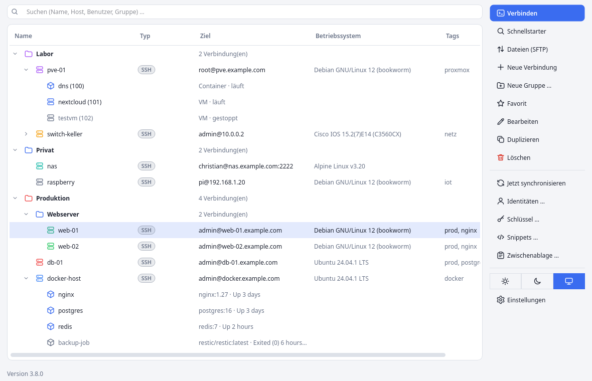
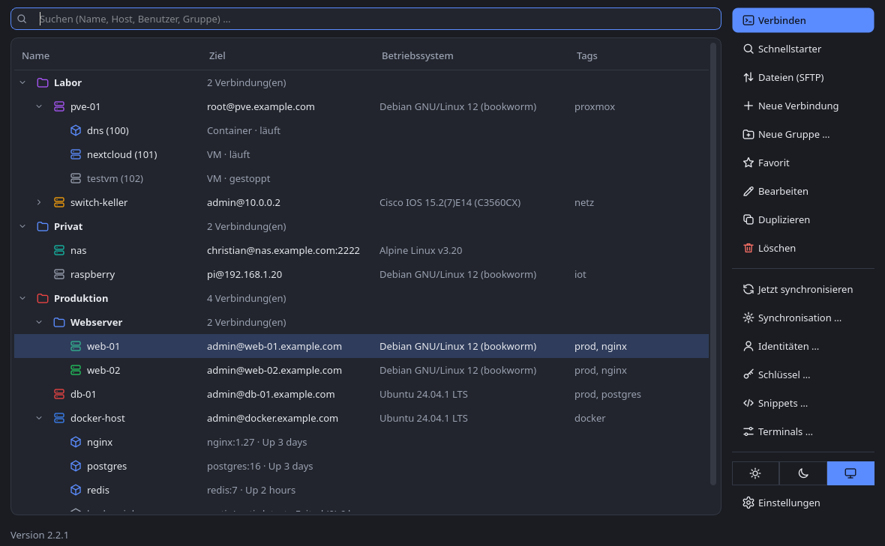
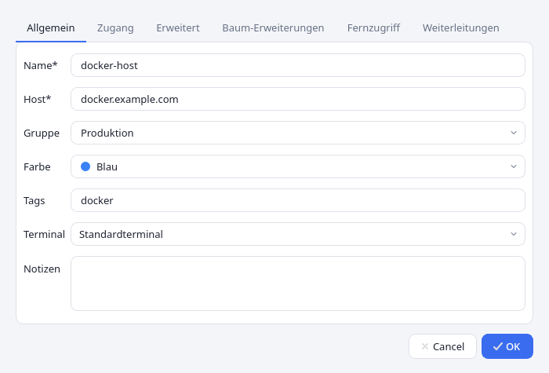
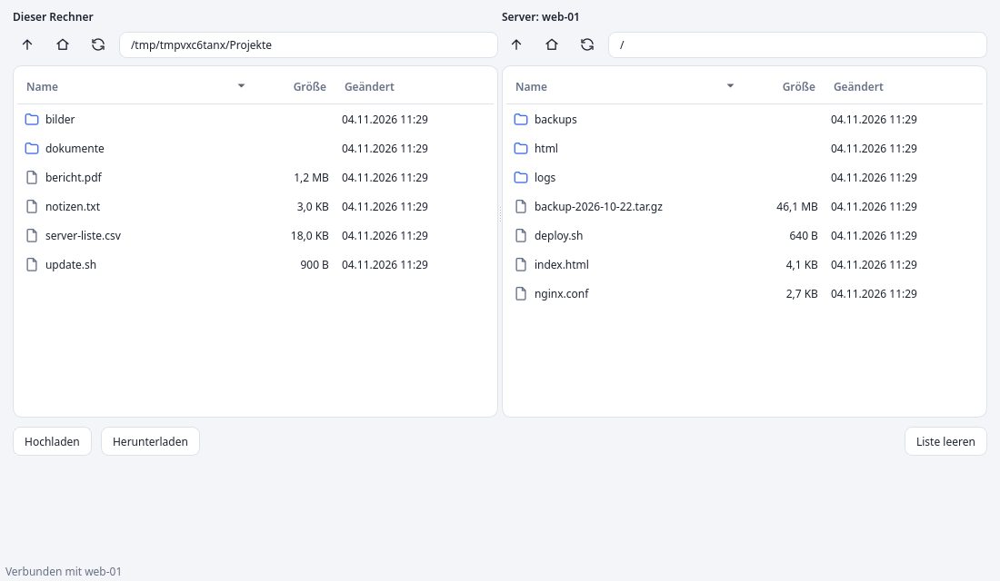
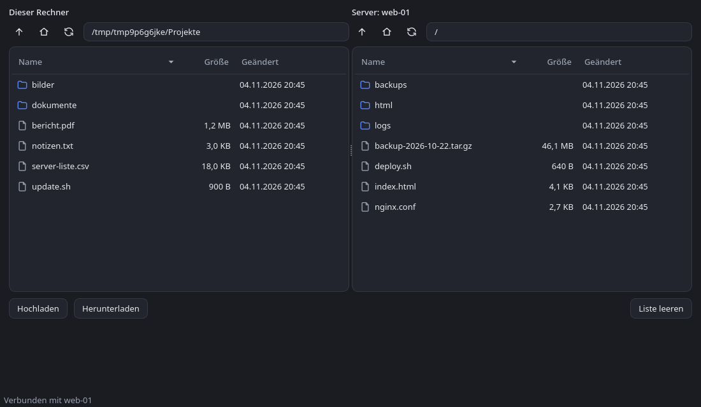
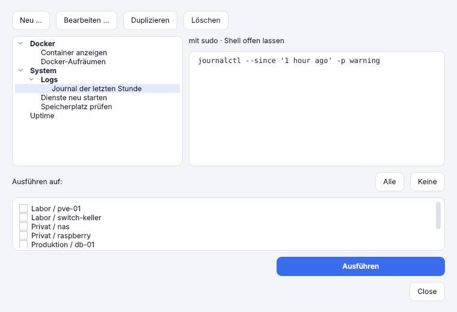
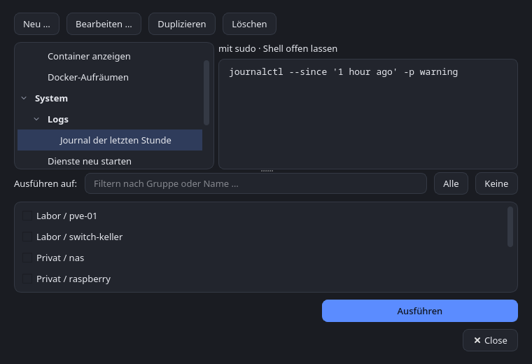

[](https://github.com/focmb/sesam/actions/workflows/build.yml)
[](https://github.com/focmb/sesam/releases/latest)
[](https://github.com/focmb/sesam/releases)
[](LICENSE)


<p align="center"></p>

# Sesam

SSH connection manager (Windows and Linux, Python + PySide6) for managing SSH connections.
Connections open in a **freely configurable terminal**.

*[Deutsche Fassung: README.md](README.md)*

## Table of contents

- [Features](#features)
- [Getting started](#getting-started)
- [Installing from the release archive (Linux)](#installing-from-the-release-archive-linux)
- [Installing in the application menu / dash (Linux)](#installing-in-the-application-menu--dash-linux)
- [Screenshots](#screenshots)
- [Documentation](#documentation)

## Features

### Connection management
SSH connections in nested groups with drag & drop, colors, tags, search and multi-select; import from `~/.ssh/config`.

### Favorites and quick launcher
Frequent connections as favorites at the top of the tree (synced too); Ctrl+K opens a fuzzy search over all connections with the recently used ones.

### Your own terminal
Every connection opens in the terminal of your choice (Windows Terminal, PowerShell, cmd, PuTTY, GNOME Terminal, custom programs) through freely configurable command templates, also different per connection.

### Credentials
Passwords live in the operating system’s keychain, not in the configuration file. Identities bundle user, key and password for many connections.

### SSH keys in the app
Generate or import Ed25519/RSA keys, view fingerprints, install them on servers with one click (like `ssh-copy-id`) and assign them to connections.

### sudo
Switch straight to root or another user after login, optionally with the stored password and without typing it again.

### Snippets
Run saved commands (with categories) on one or several hosts at once, optionally with sudo, then keep the shell open, wait for a key or close the terminal.

### File transfer (SFTP)
Two-pane file browser with drag & drop, background progress, rename, delete and new folder; no `sftp` or `scp` needed on your computer.

### Port forwarding (tunnels)
Save local (`-L`), remote (`-R`) and dynamic SOCKS (`-D`) forwardings per connection and start and stop them with a click; running tunnels show in the tree.

### Remote access (VNC and RDP)
Open a device's screen in the **built-in VNC viewer** or in the viewer of your choice (Remmina, TigerVNC, FreeRDP, mstsc), through an SSH tunnel or directly if the device only speaks VNC or RDP; the password lives in the keyring. Badges in the *Type* column show what a connection can do (SSH, VNC, RDP).

### Docker
Show a host’s containers in the connection tree; start, stop, restart and delete them, and open a shell in a container with a double-click.

### Proxmox
VMs and LXC containers in the tree, shell in LXC and VMs, start, shut down, stop and restart.

### Cisco switches
Ports in the tree with state, VLAN and speed; switch them on and off, change descriptions, save the configuration.

### WireGuard indicator (optional)
The status bar shows whether the computer is connected to a WireGuard tunnel (tunnel name; connected, stale or disconnected); a click shows details.

### Git synchronization
Sync connections, groups, identities, keys and snippets between several devices; passwords and private keys are stored encrypted only (AES-256-GCM).

### Windows and Linux
The same experience on both systems, light and dark theme, adjustable font size, interface in German and English.

## Getting started

```bash
python -m venv .venv
source .venv/bin/activate        # Windows: .venv\Scripts\activate
pip install -e .
sesam                            # or: python -m sesam
```

Without a Python environment: see “Installing from the release archive”. For a launcher in the application menu / dash see “Installing in the application menu / dash”.

## Installing from the release archive (Linux)

Every release on the [releases page](https://github.com/focmb/sesam/releases) contains `sesam-<version>-linux-x86_64.tar.gz`: a ready-built
program that runs without Python installed (built on Ubuntu 22.04). Not to be confused with the “Source code (tar.gz)” archive that GitHub
offers automatically, which only contains the source.

**Requirements:** the usual Qt libraries plus `openssh-client` and `git`. On Debian/Ubuntu:

```bash
sudo apt install libxcb-cursor0 libegl1 openssh-client git
```

Optionally check the checksum first (archive and `SHA256SUMS` of the same release in the same folder):

```bash
sha256sum -c --ignore-missing SHA256SUMS
```

**Option A: with a launcher in the application menu / dash (recommended).** The script `install.sh` is part of the source, not of the archive.
It expects the unpacked program in the repository’s `dist/` folder:

```bash
git clone https://github.com/focmb/sesam.git && cd sesam
mkdir -p dist && tar -xzf ~/Downloads/sesam-<version>-linux-x86_64.tar.gz -C dist
./packaging/linux/install.sh
```

Afterwards the program lives in `~/.local/share/sesam-app` and the `sesam` command in `~/.local/bin` (on some distributions the folder has to be
added to the `PATH` first); a launcher and icon are added as well. To update: run `git pull` in the repository, `rm -rf dist/sesam`, unpack the
new archive as above and run `install.sh` again. Remove with `./packaging/linux/install.sh --uninstall`; the configuration in `~/.config/sesam` is kept.

**Option B: just unpack and run (no menu entry).**

```bash
mkdir -p ~/opt && tar -xzf ~/Downloads/sesam-<version>-linux-x86_64.tar.gz -C ~/opt
~/opt/sesam/sesam                                  # run
ln -s ~/opt/sesam/sesam ~/.local/bin/sesam         # optional: the "sesam" command in a terminal
```

To update, do the same again with the new archive (run `rm -rf ~/opt/sesam` first). If a library is missing at startup,
`QT_DEBUG_PLUGINS=1 ~/opt/sesam/sesam` shows which one. On Arch Linux/Manjaro the pacman package from `packaging/aur` is more convenient (see [Building the program](docs/en/entwicklung.md#building-the-program-linux-and-windows)).

## Installing in the application menu / dash (Linux)

A script sets Sesam up for your user (no root needed): launcher in the application menu or dash, icon, and the `sesam` command.

```bash
./packaging/linux/install.sh --dev        # runs directly from the project folder (.venv), always current code
./packaging/linux/install.sh              # or: from the built program (dist/sesam, see docs/en/entwicklung.md and “Installing from the release archive”)
./packaging/linux/install.sh --uninstall  # removes everything again; ~/.config/sesam is kept
```

After code changes, `--dev` only needs a restart of Sesam; with the built program you have to rebuild and run the script again.
The `sesam` command lives in `~/.local/bin` (on some distributions the folder must first be added to your `PATH`).

## Screenshots

The screenshots show the German interface; the English interface looks the same apart from the texts.



| Dark | Edit connection |
| --- | --- |
|  |  |

| File browser (SFTP, light) | File browser (SFTP, dark) |
| --- | --- |
|  |  |

| Snippets (light) | Snippets (dark) |
| --- | --- |
|  |  |

The images show sample data (made-up hosts) and were created with the Qt platform plugin “offscreen”; real windows may differ in frame and font depending on the desktop.

## Documentation

The detailed guide is in the [`docs/en/`](docs/en/) folder:

| Page | Contents |
|---|---|
| [Managing connections](docs/en/verbindungen.md) | Appearance, groups, favorites and quick launcher, colors and tags, open connections |
| [Credentials and sudo](docs/en/zugangsdaten.md) | Identities, SSH keys, sudo, passwords |
| [Terminals and snippets](docs/en/terminals-snippets.md) | Configuring terminals, connection errors and host keys, snippets |
| [Files and tunnels](docs/en/dateien-tunnel.md) | SFTP file browser, port forwarding |
| [Remote access (VNC and RDP)](docs/en/fernzugriff.md) | Built-in VNC viewer, external viewers, tunnel and direct connection, password |
| [Docker, Proxmox, Cisco and WireGuard](docs/en/geraete.md) | Containers, guests, switch ports, WireGuard indicator |
| [Synchronization and data](docs/en/synchronisation.md) | Syncing via Git, where the data lives |
| [Development: building, builds and tests](docs/en/entwicklung.md) | Building the program, automatic builds, tests |
| [Release process](docs/release.md) (German) | From a code change to the installed package (Manjaro) |
