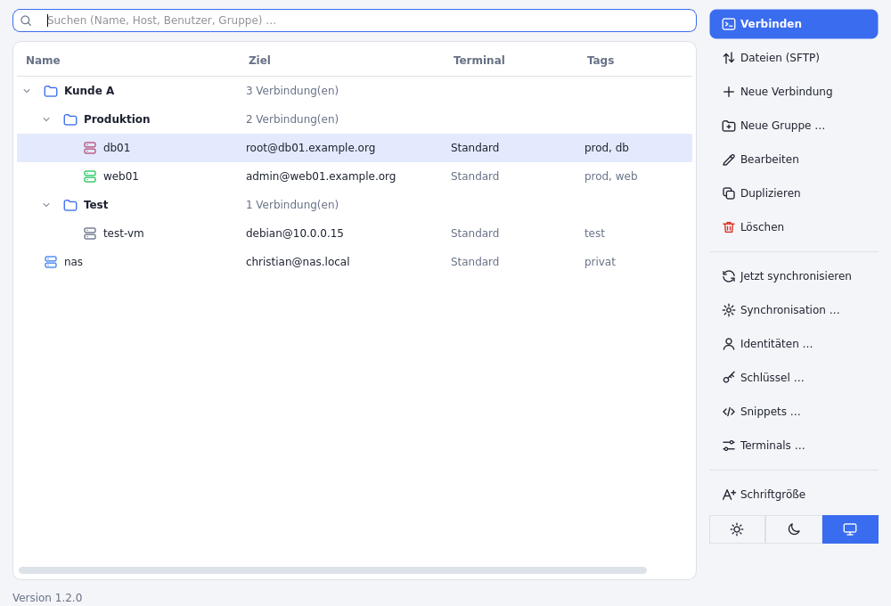
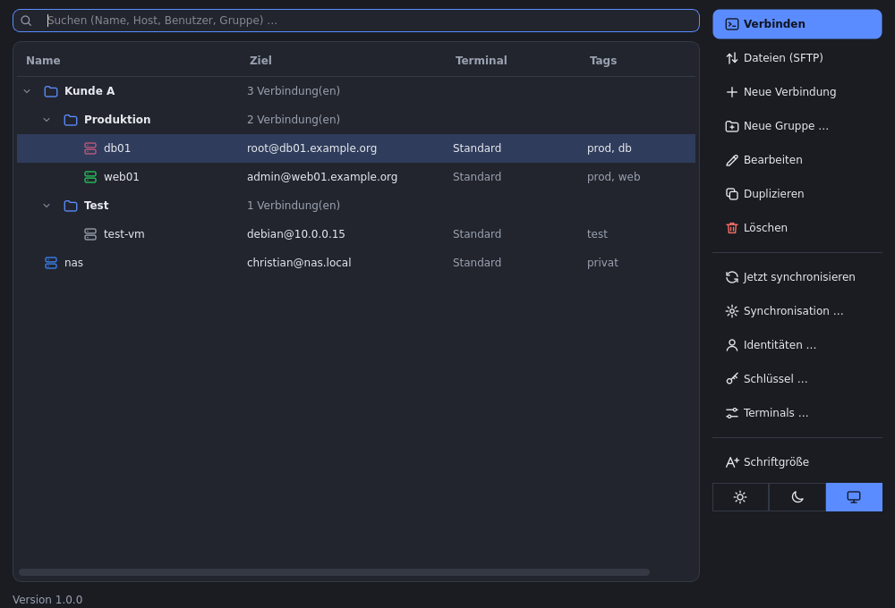
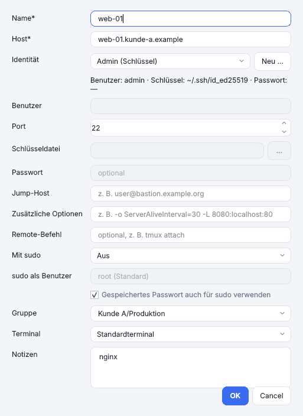
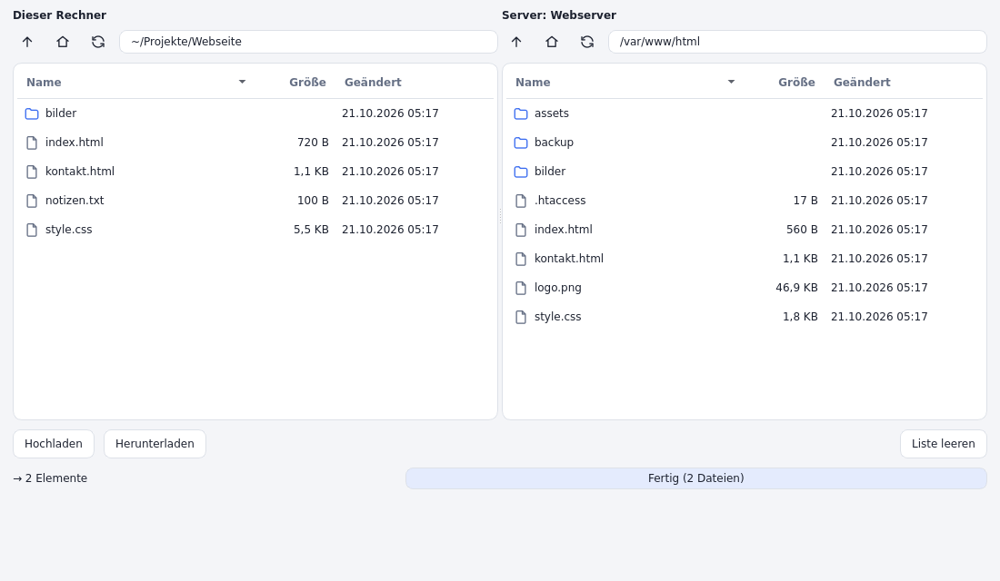
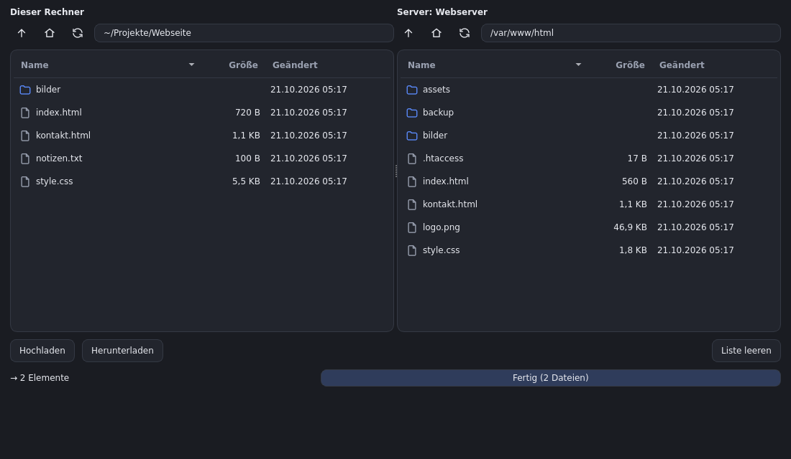

<p align="center"></p>

# Sesam

Desktop-Tool (Windows und Linux, Python + PySide6) zum Verwalten von SSH-Verbindungen.
Verbindungen werden in einem **frei konfigurierbaren Terminal** geöffnet.

## Start

```bash
python -m venv .venv
source .venv/bin/activate        # Windows: .venv\Scripts\activate
pip install -e .
sesam                            # oder: python -m sesam
```

Für einen Starter im Anwendungsmenü/Dash siehe „Im Anwendungsmenü / Dash installieren“.

## Screenshots



| Dunkel | Verbindung bearbeiten |
| --- | --- |
|  |  |

| Dateibrowser (SFTP, hell) | Dateibrowser (SFTP, dunkel) |
| --- | --- |
|  |  |

Die Bilder zeigen Beispieldaten (erfundene Hosts) und wurden mit dem Qt-Plattform-Plugin „offscreen“ erzeugt; echte Fenster können je nach Desktop in Rahmen und Schrift abweichen.

## Darstellung

Alle Hauptaktionen (Verbinden, Dateien, Neue Verbindung, Neue Gruppe, Bearbeiten, Duplizieren, Löschen, Synchronisieren, Identitäten, Terminals)
stehen untereinander in einer Seitenleiste am rechten Rand; die Tastenkürzel (Enter, Strg+N, F2, Entf, Strg+D, F5 …) gelten im ganzen Fenster.
*Duplizieren* legt eine Kopie an und öffnet sie sofort zum Bearbeiten, der Name ist markiert und lässt sich gleich überschreiben; bricht man ab, bleibt die Kopie bestehen.

*Einstellungen → Darstellung* schaltet zwischen **Systemvorgabe**, **Hell** und **Dunkel** um (wirkt sofort, wird gespeichert).
Bei *Systemvorgabe* folgt Sesam dem Hell/Dunkel-Wechsel des Betriebssystems, sofern Qt ihn meldet (Windows, macOS, Linux je nach Desktop);
andernfalls stellst du es manuell ein.

**Schriftgröße:** *Einstellungen → Schriftgröße* (80 bis 200 % der Systemschrift), oder per Tastatur **Strg + Plus** (größer), **Strg + Minus** (kleiner) und **Strg + 0** (zurück auf 100 %).
Icons und Seitenleiste wachsen mit. Die Einstellung gilt sofort, wird gespeichert und bleibt lokal (wird nicht per Git synchronisiert).

Das Erscheinungsbild (Farben, Abstände, Icons) kommt aus `src/sesam/gui/style.py`: ein gemeinsames Stylesheet für Hell und Dunkel, das aus einer
Farbtabelle (`TOKENS`) erzeugt wird. Farben änderst du dort an einer Stelle; Icons sind einfache Linienzeichnungen im gleichen Modul.
Sesam nutzt dafür überall den Qt-Stil „Fusion“, damit es unter Windows und Linux gleich aussieht.

## Im Anwendungsmenü / Dash installieren (Linux)

Ein Skript legt Sesam für deinen Benutzer an (ohne root): Starter im Anwendungsmenü bzw. Dash, Icon und den Befehl `sesam`.

```bash
./packaging/linux/install.sh --dev        # startet direkt aus dem Projektordner (.venv), immer aktueller Code
./packaging/linux/install.sh              # oder: aus dem gebauten Programm (dist/sesam, siehe „Programm bauen“)
./packaging/linux/install.sh --uninstall  # entfernt alles wieder; ~/.config/sesam bleibt erhalten
```

Nach Änderungen am Code genügt bei `--dev` ein Neustart von Sesam; beim gebauten Programm musst du neu bauen und das Skript erneut ausführen.
Der Befehl `sesam` liegt in `~/.local/bin` (bei manchen Distributionen muss der Ordner erst im `PATH` stehen).

## Gruppen

Verbindungen lassen sich in verschachtelten Gruppen ordnen (Pfad mit „/“, z. B. `Kunde A/Produktion`).
- *Neue Gruppe …* (Strg+Umschalt+N, Seitenleiste oder Kontextmenü) legt auch leere Gruppen an; im Kontextmenü einer Gruppe: Untergruppe, Umbenennen/Verschieben, Löschen.
- Per **Drag & Drop** verschiebst du Verbindungen und ganze Gruppen; Ablegen auf freier Fläche = oberste Ebene.
- Eine Gruppe zu löschen entfernt keine Verbindungen, sie rücken in die übergeordnete Gruppe.
- Neue Verbindungen landen in der aktuell ausgewählten Gruppe. Das Suchfeld filtert auch nach Gruppen.
- Auf- und Zugeklapptes merkt sich Sesam: Beim nächsten Start sind genau die Gruppen zu, die beim Beenden zu waren. Dieser Zustand (wie die Spaltenbreiten) bleibt lokal und wird nicht per Git synchronisiert.

## Farben und Tags

- **Farbe:** Verbindungen und Gruppen können eine von acht Farben bekommen; sie färbt das Symbol im Baum (die Zeile selbst bleibt unverändert, auch im dunklen Design gut lesbar).
  Bei Verbindungen wählst du sie im Bearbeiten-Dialog (*Farbe*) oder per Rechtsklick → *Farbe*, bei Gruppen per Rechtsklick → *Farbe*. Eine Gruppenfarbe wandert beim Umbenennen und Verschieben mit.
- **Tags:** Eine Verbindung kann mehrere Tags tragen (*Tags* im Bearbeiten-Dialog, mit Komma trennen, z. B. `prod, kunde-a`). Der Dialog schlägt bereits vergebene Tags vor.
  Der Baum zeigt sie in der Spalte *Tags*, und das Suchfeld findet sie wie Namen, Hosts und Gruppen. Groß-/Kleinschreibung spielt keine Rolle.
- Farben und Tags werden mit synchronisiert (Gruppenfarben in `groups.json`). Bei widersprüchlichen Änderungen derselben Gruppenfarbe gewinnt die lokale.
- Die Spaltenbreiten der Hauptansicht werden einmalig auf die Standardwerte zurückgesetzt, weil eine Spalte dazukam.

## Terminals konfigurieren

Unter *Einstellungen → Terminals …* legst du Terminals als Befehlsvorlage an und wählst ein Standardterminal.
Pro Verbindung kann ein abweichendes Terminal gewählt werden; im Kontextmenü gibt es „Verbinden mit …“.

| Platzhalter | Bedeutung |
|---|---|
| `{ssh_args}` | ssh-Befehl als einzelne Argumente |
| `{ssh_command}` | ssh-Befehl als ein String |
| `{title}` `{host}` `{user}` `{port}` `{destination}` | Verbindungsdaten |

Beispiele: `gnome-terminal --title {title} -- {ssh_args}`, `wt.exe new-tab --title {title} {ssh_args}`,
`cmd.exe /k {ssh_command}`, `putty.exe -ssh -P {port} {destination}`.

Beim ersten Start werden auf dem System gefundene Terminals vorbelegt.

Eigene Terminals (z. B. Ghostty) legst du über *Neu ▾ → Eigenes Terminal* an. Mit „Programm wählen …“ kannst du die
ausführbare Datei auswählen, falls sie nicht im `PATH` liegt (z. B. AppImage). Die Vorlagen für nicht installierte Terminals
findest du ebenfalls unter *Neu ▾*.

## Identitäten

Eine Identität bündelt **Benutzer, Schlüsseldatei und Passwort** und kann von beliebig vielen Verbindungen verwendet werden.
- Verwalten unter *Einstellungen → Identitäten …* (oder Seitenleiste) oder direkt beim Anlegen einer Verbindung über *Identität → Neu …*.
- Wählst du in einer Verbindung eine Identität, ersetzt sie Benutzer, Schlüsseldatei und Passwort der Verbindung (die Felder sind dann gesperrt, die eigenen Werte bleiben erhalten und gelten wieder bei „Keine“).
- Das Passwort liegt im Schlüsselbund, einmal pro Identität. Ändert sich ein Passwort, wird es nur an einer Stelle angepasst. Das gilt auch für sudo.
- Eine Identität zu löschen entfernt sie auch aus allen Verbindungen, die sie nutzen (diese brauchen danach wieder eigene Zugangsdaten).

## SSH-Schlüssel

*Einstellungen → Schlüssel …* (oder Seitenleiste) verwaltet Schlüssel direkt in Sesam – unter Windows und Linux gleich.
- **Erzeugen:** Ed25519 (empfohlen) oder RSA 4096, optional mit Passphrase. Das Format ist das normale OpenSSH-Format, `ssh-keygen` und Terminals verstehen es.
- **Importieren:** eine vorhandene private Schlüsseldatei einlesen (OpenSSH oder klassisches PEM). Liegt daneben eine `.pub`-Datei, wird sie für geschützte Schlüssel genutzt, sonst fragt Sesam einmal nach der Passphrase.
- **Ansehen:** Typ, Fingerabdruck (SHA256 wie bei `ssh-keygen -l`), Kommentar, Erstelldatum, öffentlicher Schlüssel und wer den Schlüssel verwendet. *Öffentlichen Schlüssel kopieren* legt die Zeile für `authorized_keys` in die Zwischenablage.
- **Auf Server installieren:** wie `ssh-copy-id`. Du wählst eine Verbindung, Sesam trägt den Schlüssel in `~/.ssh/authorized_keys` ein (Rechte werden gesetzt, doppelte Einträge vermieden). Die Anmeldung muss dafür einmalig klappen; bei Bedarf wird nach dem Passwort gefragt.
- **Zuweisen:** in Verbindung und Identität unter *Gespeicherter Schlüssel*. Er ersetzt dann die Schlüsseldatei und gilt für Terminal, SFTP und Docker. Eine Identität hat Vorrang vor der Verbindung.
- **Löschen:** entfernt den Schlüssel (privat und öffentlich) und hebt Zuweisungen auf. Auf Servern eingetragene öffentliche Schlüssel bleiben dort bestehen.
- **Speicherort:** der private Teil liegt als Datei (Rechte 0600) im Konfigurationsordner unter `keys/`, nicht im Schlüsselbund, weil `ssh -i` eine Datei braucht und der Windows-Speicher für große Schlüssel zu klein ist.
- **Synchronisation:** Name, Typ, Fingerabdruck und öffentlicher Schlüssel werden immer abgeglichen. Der **private Teil** wandert nur verschlüsselt und nur, wenn die Passwort-Synchronisation (mit Sync-Passwort) aktiv ist. Ohne sie zeigt Sesam auf anderen Geräten „privater Schlüssel auf diesem Gerät: nein“.

## sudo

Pro Verbindung kannst du *Mit sudo* aktivieren: nach dem Login wechselt die Sitzung direkt zu root oder einem anderen Benutzer
(`sudo -i` = Login-Shell, `sudo -s` = Shell mit bisheriger Umgebung; Zielbenutzer optional). Zusätzlich gibt es im Kontextmenü
*Als root verbinden (sudo -i)* für einen einmaligen Wechsel, ohne die Verbindung zu ändern.

**sudo ohne erneute Eingabe:** Ist für die Verbindung ein Passwort gespeichert und *Gespeichertes Passwort auch für sudo verwenden*
aktiv (Standard), wird es für sudo automatisch genutzt. Es wird nie als Kommandozeilenargument übergeben, sondern verschlüsselt
als Umgebungsvariable `LC_SSHV_PW` (`ssh -o SendEnv=…`) in die Sitzung gereicht. Auf dem Server prüft `sudo -S -v` es genau
einmal, danach startet `sudo -i`/`sudo -s` ohne Abfrage.
- Der Server muss `LC_*` per `AcceptEnv` zulassen (Debian/Ubuntu: Standard). Sonst, oder bei falschem Passwort, fragt sudo wie gewohnt im Terminal.
- Das Passwort ist in der Sitzungsumgebung kurz für den eigenen Benutzer und root auf dem Server lesbar. Für sudo selbst wird die Variable entfernt.
- Funktioniert auch bei Anmeldung per Schlüssel: Das gespeicherte Passwort wird dann nur für sudo gebraucht.

## Passwörter

Pro Verbindung kann ein Passwort hinterlegt werden. Es wird im Schlüsselbund des Betriebssystems gespeichert
(Secret Service/GNOME Keyring/KWallet unter Linux, Anmeldeinformationsverwaltung unter Windows), **nicht** in `config.json`.
Beim Verbinden startet das Terminal `ssh` über einen kleinen Wrapper, der das Passwort per `SSH_ASKPASS` übergibt
(OpenSSH ≥ 8.4). Hinweise:
- Auf Passwortabfragen wird automatisch geantwortet, auf andere Abfragen (Passphrase, 2FA-Code) nicht.
- Unbekannte Hosts werden automatisch in `known_hosts` aufgenommen (`StrictHostKeyChecking=accept-new`), geänderte Schlüssel werden weiterhin abgelehnt. Setzt du die Option selbst unter „Zusätzliche Optionen“, hat sie Vorrang.

## Dateien übertragen (SFTP)

*Dateien (SFTP)* (F4, Seitenleiste oder Kontextmenü einer Verbindung) öffnet einen Dateibrowser: links dein Rechner, rechts der Server.
- **Übertragen:** Dateien und Ordner per **Drag & Drop** zwischen den Seiten ziehen, mit den Knöpfen *Hochladen* / *Herunterladen* oder über das Kontextmenü.
  Auf der Serverseite kannst du auch Dateien direkt aus dem Dateimanager ablegen; wirfst du auf einen Ordner, landen sie darin.
- **Fortschritt:** Jede Übertragung läuft im Hintergrund mit eigenem Fortschrittsbalken und lässt sich abbrechen (eine halb übertragene Datei wird dabei entfernt). Mehrere Übertragungen laufen gleichzeitig.
- **Vorhandene Dateien:** Gibt es am Ziel schon gleichnamige Einträge, fragt Sesam: *Überschreiben*, *Überspringen* oder *Abbrechen*. Die Wahl gilt für die Einträge der obersten Ebene; Dateien in übertragenen Ordnern werden bei *Überschreiben* ersetzt.
- **Verwalten:** *Neuer Ordner*, *Umbenennen* (F2) auf beiden Seiten, *Löschen* (Entf) auf dem Server (nach Rückfrage, Ordner samt Inhalt). Pfadzeile (Strg+L), „Eine Ebene höher“, Persönlicher Ordner und Aktualisieren (F5) gibt es je Seite; die Spalten lassen sich sortieren.
- **Anmeldung:** wie beim Terminal, also mit Benutzer, Schlüsseldatei oder dem im Schlüsselbund gespeicherten Passwort (auch über eine Identität). Ist nichts hinterlegt oder wird es abgelehnt, fragt Sesam einmal nach; dieses Passwort gilt nur für das geöffnete Fenster und wird nicht gespeichert.
  Unbekannte Hosts werden wie bei ssh in `known_hosts` aufgenommen, geänderte Schlüssel abgelehnt.
- **Grenzen:** Verbindungen mit **Jump-Host** werden noch nicht unterstützt, „Zusätzliche Optionen“ und *Mit sudo* gelten nicht für die Dateiübertragung (es wird mit dem Benutzer der Verbindung gearbeitet, nicht als root).
  Verknüpfungen auf Ordner werden beim Herunterladen nicht verfolgt (Schutz vor Schleifen), Verknüpfungen auf Dateien als Datei übertragen.
- Die Übertragung nutzt die Python-Bibliothek *paramiko*, braucht also kein `sftp`/`scp` auf dem Rechner.

## Docker-Container

Läuft auf einem Host Docker, kannst du direkt in einen Container verbinden. In der Verbindung (*Bearbeiten*) den Haken
**Docker-Container dieses Hosts im Verbindungsbaum anzeigen** setzen; optional lassen sich Standard-Shell und -Benutzer für die Container festlegen.
- **Im Baum:** Der Host bekommt einen Pfeil. Beim Aufklappen fragt Sesam den Host per SSH nach seinen *laufenden* Containern (`docker ps`) und zeigt sie als Unterelemente
  (Name, Image, Status). Erst beim Aufklappen wird verbunden; *Container aktualisieren* (Kontextmenü) lädt neu.
- **Verbinden:** Doppelklick oder Enter öffnet im Terminal eine Shell im Container (`docker exec -it`). Ohne feste Shell nimmt Sesam `bash`, sonst `sh`.
  *Verbinden als …* fragt Shell und Benutzer (z. B. `root`) für diesen einen Aufruf ab; *Verbinden mit …* wählt ein anderes Terminal.
- **Anmeldung:** Passwort und Schlüssel der Verbindung werden wie beim Terminal und bei SFTP verwendet. Ist keins gespeichert, fragt Sesam einmal nach
  (das Passwort bleibt nur im Speicher). Verbindungen über einen Jump-Host zeigen die Container noch nicht an.
- Der Docker-Benutzer braucht Zugriff auf den Docker-Socket (Gruppe `docker`); `sudo docker` wird nicht verwendet. Die Einstellungen werden mit synchronisiert,
  die Container selbst nicht.

## Synchronisation über Git

*Einstellungen → Synchronisation …* gleicht Verbindungen, Gruppen, Identitäten und Schlüssel über ein Git-Repository ab (Terminals und
Fensterbreiten bleiben pro Gerät). Das Tool nutzt das installierte `git`; die Anmeldung läuft also über deine SSH-Schlüssel bzw.
gespeicherten HTTPS-Zugangsdaten (im Hintergrund ohne Rückfragen, einmal vorher per *Verbindung testen* oder `git ls-remote` anmelden).

- **Automatisch:** beim Start und kurz nach jeder Änderung. *F5* bzw. *Jetzt synchronisieren* löst den Abgleich manuell aus; der Status steht rechts unten.
- **Repository-Aufbau:** eine JSON-Datei pro Eintrag (`connections/`, `identities/`, `ssh_keys/`), `groups.json`, `meta.json`. Das Repository darf privat sein, ist aber für Klartext-Daten wie Hostnamen und Benutzer sichtbar.
- **Passwörter** werden nur verschlüsselt abgelegt (scrypt + AES-256-GCM) und auf jedem Gerät in den Schlüsselbund geschrieben. Das **Sync-Passwort** legst du auf dem ersten Gerät fest und gibst es auf jedem weiteren ein. Es lässt sich nicht wiederherstellen und auch nicht ohne Weiteres ändern. Ohne Passwort-Sync bleiben vorhandene verschlüsselte Einträge im Repository erhalten.
- **Zusammenführen:** je Eintrag ein Dreiwege-Vergleich mit dem Stand des letzten Abgleichs. Änderungen an verschiedenen Einträgen werden kombiniert, Löschungen übernommen. Wurde derselbe Eintrag auf zwei Geräten unterschiedlich geändert, bleibt deine lokale Version und die andere erscheint als „… (Konflikt)“.
- Wird eine Identität oder ein Schlüssel gelöscht, verlieren Verbindungen, die sie nutzen, den Verweis.
- Leeres Repository anlegen (z. B. bei GitHub/GitLab/Gitea) genügt, das Tool erstellt den Branch selbst.

## Daten

Konfiguration: `~/.config/sesam/config.json` (Linux), `%APPDATA%\sesam\config.json` (Windows).
Passwörter stehen nie in dieser Datei, sondern im Schlüsselbund des Betriebssystems; ohne gespeichertes Passwort läuft die Anmeldung über ssh (Schlüssel, Agent, Abfrage im Terminal).

Ist `config.json` beschädigt (kein gültiges JSON o. Ä.), löscht Sesam sie nicht: Die Datei wird als `config.json.defekt-<Datum>-<Uhrzeit>` daneben gesichert,
Sesam zeigt eine Meldung mit dem Grund und startet mit leerer Konfiguration. Du kannst die Sicherung reparieren und als `config.json` zurückkopieren.
Mit aktiver Git-Synchronisation richtest du sie wieder ein; die Verbindungen kommen dann aus dem Repository zurück. Kann die Datei nicht gelesen oder nicht gesichert werden,
startet Sesam nicht und ändert nichts.

Alte Daten aus der früheren Version („ssh_verwaltung“) werden beim ersten Start automatisch übernommen: der Konfigurationsordner wird umbenannt, Passwörter ziehen im Schlüsselbund um.

## Programm bauen (Linux und Windows)

Mit PyInstaller entsteht ein Programmordner, der ohne installiertes Python läuft. Gebaut wird auf dem jeweiligen Zielsystem
(Linux auf Linux, Windows auf Windows; Cross-Kompilieren geht nicht):

```bash
python -m venv .venv && source .venv/bin/activate      # Windows: .venv\Scripts\activate
pip install -e . pyinstaller
python packaging/build.py
```

Ergebnis in `dist/`: der Ordner `sesam/` und ein Archiv (`sesam-<Version>-linux-x86_64.tar.gz` bzw. `…-windows-x86_64.zip`).
- **Linux:** `sesam/sesam` starten. Zielsysteme brauchen die üblichen Qt-Bibliotheken, bei Ubuntu/Debian z. B. `libxcb-cursor0` und `libegl1`
  (`QT_DEBUG_PLUGINS=1 ./sesam` zeigt, was fehlt). Gebaut wird gegen die glibc des Build-Systems; für möglichst viele Systeme auf einer älteren
  Distribution bauen (getestet: Ubuntu 22.04).
- **Debian/Ubuntu-Paket:** `python packaging/build_deb.py` (nach `build.py`) erzeugt `dist/sesam_<Version>_amd64.deb`. Installieren mit
  `sudo apt install ./sesam_<Version>_amd64.deb`: Das Programm liegt in `/opt/sesam`, der Befehl `sesam` in `/usr/bin`, dazu Starter und Icon
  für das Anwendungsmenü; `apt` zieht die nötigen Qt-Bibliotheken, `openssh-client` und `git` nach. Entfernen mit `sudo apt remove sesam`
  (die Konfiguration in `~/.config/sesam` bleibt). Das Paket entsteht auf Debian/Ubuntu (braucht `dpkg-deb`); für möglichst viele Systeme
  auf Ubuntu 22.04 bauen.
- **Release-Dateien:** Prüfsummen für den Release: `cd dist && sha256sum *.tar.gz *.deb > SHA256SUMS`.
- **Windows:** `sesam\sesam.exe` starten (Fenster ohne Konsole). Der Ordner enthält zusätzlich `sesam-cli.exe`; der ssh-Wrapper (Passwort/sudo)
  braucht eine Konsole und nutzt diese Variante automatisch. Voraussetzungen: OpenSSH-Client (Windows-Feature) und Git. Unsignierte Programme
  löst SmartScreen u. U. eine Warnung aus.
  Das Icon der `.exe` liegt als `packaging/windows/sesam.ico` im Repository; bei geändertem Programm-Icon neu erzeugen mit `python packaging/make_icon.py`.
- Es ist bewusst keine Ein-Datei-Variante: der Wrapper startet Sesam bei jeder Verbindung erneut, Entpacken würde jedes Mal dauern.

## Automatischer Build (Gitea Actions)

`.gitea/workflows/build.yml` läuft bei jedem Tag `v*` (z. B. `git tag v1.0.0 && git push --tags`) und auf Knopfdruck
(*Actions → Build → Run workflow*). Der Linux-Job installiert die Qt-Systembibliotheken, führt die Tests aus und baut mit
`packaging/build.py` und `packaging/build_deb.py`; `.tar.gz`, `.deb` und `SHA256SUMS` hängen als Artefakt `sesam-linux` am Lauf
(von dort lassen sie sich herunterladen und als Release anhängen).

Voraussetzung ist ein Gitea-Runner (`act_runner`, z. B. als Container neben Gitea) mit dem Label `ubuntu-22.04`,
etwa `ubuntu-22.04:docker://catthehacker/ubuntu:act-22.04`. Der Windows-Job steht auskommentiert im Workflow, bis ein Windows-Runner
(Label `windows`, mit Python und Git) existiert; bis dahin wird Windows von Hand gebaut (siehe oben).

## Tests

```bash
PYTHONPATH=src python -m unittest discover -s tests      # oder: python -m pytest
```

Die GUI-Tests laufen ohne Bildschirm (`QT_QPA_PLATFORM=offscreen` wird gesetzt) und werden übersprungen, wenn PySide6 oder die
Qt-Systembibliotheken fehlen. Die Sync-Tests brauchen `git`.
Die Paket-Tests (`test_packaging.py`) brauchen `dpkg-deb` und werden sonst übersprungen.
Die SFTP-Tests (`test_sftp.py`, `test_sftp_gui.py`) starten dafür einen kleinen SSH/SFTP-Server im Testprozess (nur auf `127.0.0.1`, mit
`paramiko`) und werden übersprungen, wenn `paramiko` fehlt. Dasselbe gilt für die Docker-Tests (`test_docker.py`, `test_docker_gui.py`); der Testserver
antwortet dort auf `docker ps`.
