[](https://github.com/focmb/sesam/actions/workflows/build.yml)
[](https://github.com/focmb/sesam/releases/latest)
[](https://github.com/focmb/sesam/releases)
[](LICENSE)


<p align="center"></p>

# Sesam

SSH-Verbindungsmanager (Windows und Linux, Python + PySide6) zum Verwalten von SSH-Verbindungen.
Verbindungen werden in einem **frei konfigurierbaren Terminal** geöffnet.

*[English version: README.en.md](README.en.md)*

## Inhaltsverzeichnis

- [Funktionen](#funktionen)
- [Start](#start)
- [Aus dem Release-Archiv installieren (Linux)](#aus-dem-release-archiv-installieren-linux)
- [Im Anwendungsmenü / Dash installieren (Linux)](#im-anwendungsmenü--dash-installieren-linux)
- [Screenshots](#screenshots)
- [Dokumentation](#dokumentation)

## Funktionen

### Verbindungsverwaltung
SSH-Verbindungen in verschachtelten Gruppen mit Drag & Drop, Farben, Tags, Suche und Mehrfachauswahl; Import aus `~/.ssh/config`.

### Favoriten und Schnellstarter
Häufige Verbindungen als Favoriten oben im Baum (werden mit synchronisiert); Strg+K öffnet eine unscharfe Suche über alle Verbindungen mit den zuletzt verwendeten.

### Eigenes Terminal
Jede Verbindung öffnet sich im Terminal deiner Wahl (Windows Terminal, PowerShell, cmd, PuTTY, GNOME Terminal, eigene Programme) über frei konfigurierbare Befehlsvorlagen, auch pro Verbindung verschieden.

### Integriertes Terminal
Verbindungen öffnen sich auf Wunsch direkt in einem Reiter von Sesam, ohne externes Terminal (Auswahl, Kopieren, Verlauf, Schriftgröße). Mehrere Sitzungen lassen sich als **Kacheln** nebeneinander oder untereinander zeigen (per Drag & Drop umsortierbar), auf Knopfdruck **alle Sitzungen als Raster**; optional geht die Eingabe an **alle Kacheln gleichzeitig** (ausdrücklich zuschaltbar, deutlich gekennzeichnet).

### Zwischenablage-Verlauf
Im Terminal Kopiertes bleibt abrufbar und lässt sich in einem oder mehreren Terminals einfügen; der Verlauf wird verschlüsselt gespeichert und nie synchronisiert.

### Zugangsdaten
Passwörter im Schlüsselbund des Betriebssystems, nicht in der Konfigurationsdatei. Identitäten bündeln Benutzer, Schlüssel und Passwort für viele Verbindungen.

### SSH-Schlüssel in der App
Ed25519/RSA erzeugen oder importieren, Fingerabdruck ansehen, per Klick auf Server installieren (wie `ssh-copy-id`) und Verbindungen zuweisen.

### sudo
Nach dem Login direkt zu root oder einem anderen Benutzer wechseln, auf Wunsch mit dem gespeicherten Passwort und ohne erneute Eingabe.

### Snippets
Gespeicherte Befehle (mit Kategorien) auf einem oder mehreren Hosts gleichzeitig ausführen, optional mit sudo, danach Shell offen lassen, auf eine Taste warten oder das Terminal schließen.

### Dateien übertragen (SFTP)
Zweigeteilter Dateibrowser mit Drag & Drop, Fortschritt im Hintergrund, Umbenennen, Löschen und Ordner anlegen, ohne `sftp` oder `scp` auf dem Rechner.

### Port-Weiterleitungen (Tunnel)
Lokale (`-L`), Remote- (`-R`) und dynamische SOCKS-Weiterleitungen (`-D`) je Verbindung speichern und per Klick starten und beenden; laufende Tunnel zeigt der Baum an.

### Fernzugriff (VNC und RDP)
Den Bildschirm eines Geräts öffnen, im **eingebauten VNC-Viewer** oder im Viewer deiner Wahl (Remmina, TigerVNC, FreeRDP, mstsc), durch einen SSH-Tunnel oder direkt, wenn das Gerät nur VNC oder RDP spricht; das Passwort liegt im Schlüsselbund. Abzeichen in der Spalte *Typ* zeigen, was eine Verbindung kann (SSH, VNC, RDP).

### Docker
Container eines Hosts im Verbindungsbaum anzeigen, starten, stoppen, neu starten, löschen und per Doppelklick eine Shell im Container öffnen.

### Proxmox
VMs und LXC-Container des jeweiligen Knotens im Baum (in einem Cluster je Knoten eine Verbindung), Shell in LXC und VM, Starten, Herunterfahren, Stoppen und Neustarten.

### Cisco-Switches
Ports im Baum mit Zustand, VLAN und Geschwindigkeit; ein- und ausschalten, Beschreibung ändern, Konfiguration speichern.

### WireGuard-Anzeige (optional)
Die Statuszeile zeigt, ob der Rechner mit einem WireGuard-Tunnel verbunden ist (Tunnelname, verbunden, veraltet oder getrennt); ein Klick zeigt Einzelheiten.

### Synchronisation über Git
Verbindungen, Gruppen, Identitäten, Schlüssel und Snippets zwischen mehreren Geräten abgleichen; Passwörter und private Schlüssel nur verschlüsselt (AES-256-GCM).

### Windows und Linux
Gleiche Bedienung auf beiden Systemen, helles und dunkles Design, einstellbare Schriftgröße, Oberfläche auf Deutsch und Englisch. Terminals, Viewer und Synchronisation verwaltest du in den **Einstellungen**.

## Start

```bash
python -m venv .venv
source .venv/bin/activate        # Windows: .venv\Scripts\activate
pip install -e .
sesam                            # oder: python -m sesam
```

Ohne Python-Umgebung: siehe „Aus dem Release-Archiv installieren“. Für einen Starter im Anwendungsmenü/Dash siehe „Im Anwendungsmenü / Dash installieren“.

## Aus dem Release-Archiv installieren (Linux)

Auf der [Release-Seite](https://github.com/focmb/sesam/releases) liegt zu jeder Version `sesam-<Version>-linux-x86_64.tar.gz`: ein fertig
gebautes Programm, das ohne installiertes Python läuft (gebaut auf Ubuntu 22.04). Nicht zu verwechseln mit dem Archiv „Source code (tar.gz)“,
das GitHub automatisch anbietet und das nur den Quelltext enthält.

**Voraussetzungen:** die üblichen Qt-Bibliotheken sowie `openssh-client` und `git`. Unter Debian/Ubuntu:

```bash
sudo apt install libxcb-cursor0 libegl1 openssh-client git
```

Optional vorher die Prüfsumme kontrollieren (Archiv und `SHA256SUMS` aus demselben Release im selben Ordner):

```bash
sha256sum -c --ignore-missing SHA256SUMS
```

**Variante A: mit Starter im Anwendungsmenü/Dash (empfohlen).** Das Skript `install.sh` liegt im Quelltext, nicht im Archiv. Es erwartet das
entpackte Programm im Ordner `dist/` des Repositorys:

```bash
git clone https://github.com/focmb/sesam.git && cd sesam
mkdir -p dist && tar -xzf ~/Downloads/sesam-<Version>-linux-x86_64.tar.gz -C dist
./packaging/linux/install.sh
```

Das Programm liegt danach in `~/.local/share/sesam-app`, der Befehl `sesam` in `~/.local/bin` (bei manchen Distributionen muss der Ordner erst
im `PATH` stehen), dazu kommen Starter und Icon. Für ein Update: im Repository `git pull`, `rm -rf dist/sesam`, das neue Archiv wie oben
entpacken und `install.sh` erneut ausführen. Entfernen mit `./packaging/linux/install.sh --uninstall`; die Konfiguration in `~/.config/sesam` bleibt erhalten.

**Variante B: nur entpacken und starten (ohne Menüeintrag).**

```bash
mkdir -p ~/opt && tar -xzf ~/Downloads/sesam-<Version>-linux-x86_64.tar.gz -C ~/opt
~/opt/sesam/sesam                                  # starten
ln -s ~/opt/sesam/sesam ~/.local/bin/sesam         # optional: Befehl „sesam“ im Terminal
```

Ein Update ist dasselbe noch einmal mit dem neuen Archiv (vorher `rm -rf ~/opt/sesam`). Fehlt beim Start eine Bibliothek, zeigt
`QT_DEBUG_PLUGINS=1 ~/opt/sesam/sesam`, welche. Unter Arch Linux/Manjaro ist das Pacman-Paket aus `packaging/aur` bequemer (siehe [Programm bauen](docs/entwicklung.md#programm-bauen-linux-und-windows)).

## Im Anwendungsmenü / Dash installieren (Linux)

Ein Skript legt Sesam für deinen Benutzer an (ohne root): Starter im Anwendungsmenü bzw. Dash, Icon und den Befehl `sesam`.

```bash
./packaging/linux/install.sh --dev        # startet direkt aus dem Projektordner (.venv), immer aktueller Code
./packaging/linux/install.sh              # oder: aus dem gebauten Programm (dist/sesam, siehe docs/entwicklung.md und „Aus dem Release-Archiv installieren“)
./packaging/linux/install.sh --uninstall  # entfernt alles wieder; ~/.config/sesam bleibt erhalten
```

Nach Änderungen am Code genügt bei `--dev` ein Neustart von Sesam; beim gebauten Programm musst du neu bauen und das Skript erneut ausführen.
Der Befehl `sesam` liegt in `~/.local/bin` (bei manchen Distributionen muss der Ordner erst im `PATH` stehen).

## Screenshots

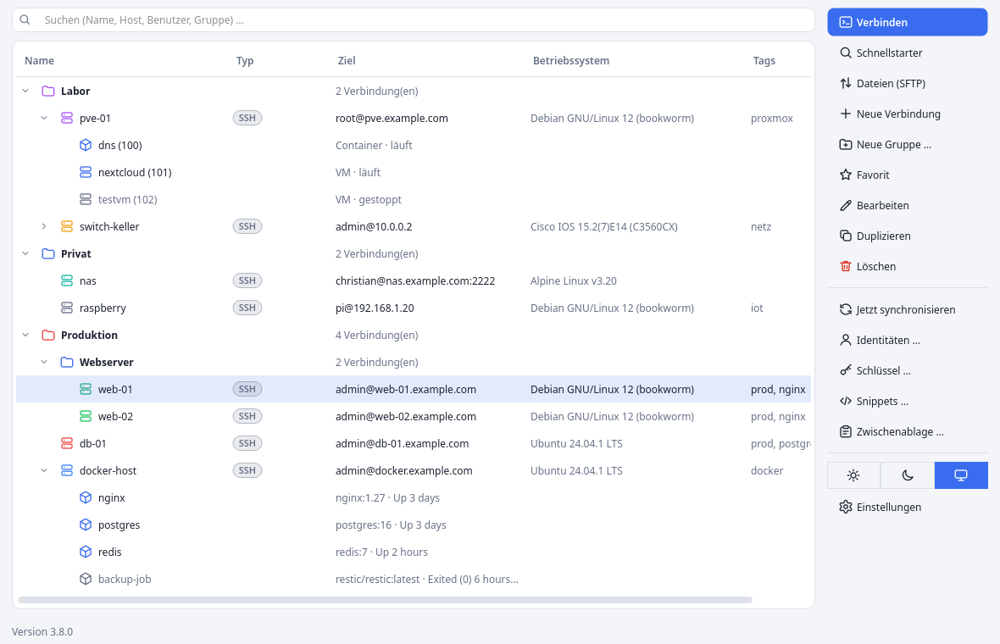


| Dunkel                                                             | Verbindung bearbeiten                                                           |
| ------------------------------------------------------------------ | ------------------------------------------------------------------------------- |
| 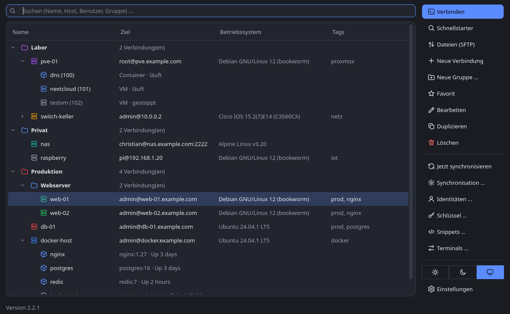 | 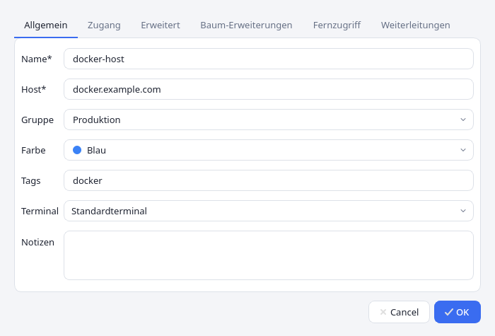 |


| Dateibrowser (SFTP, hell)                                      | Dateibrowser (SFTP, dunkel)                                        |
| -------------------------------------------------------------- | ------------------------------------------------------------------ |
| 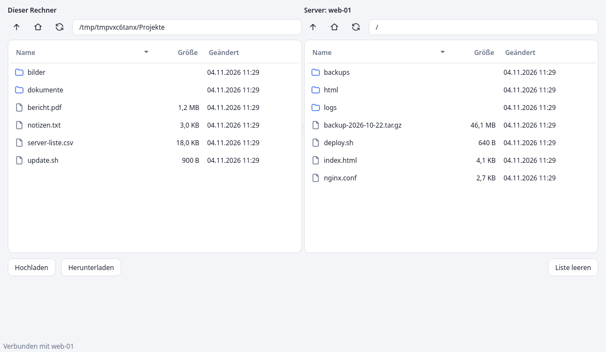 | 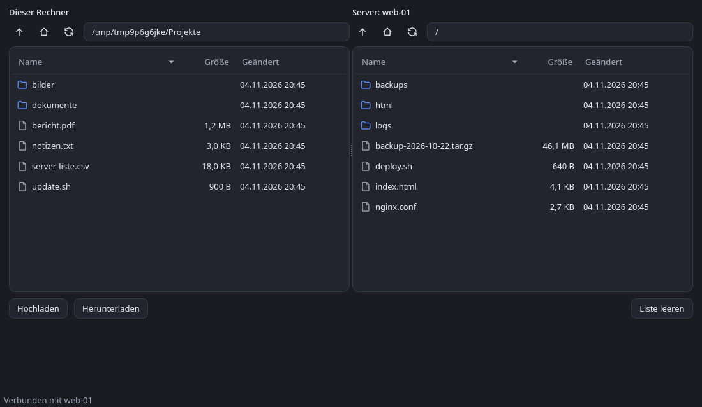 |


| Snippets (hell)                                        | Snippets (dunkel)                                          |
| ------------------------------------------------------ | ---------------------------------------------------------- |
| 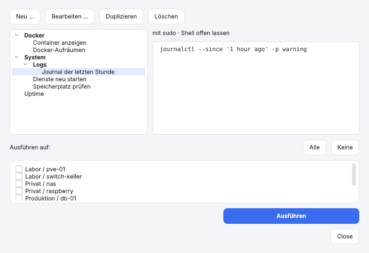 | 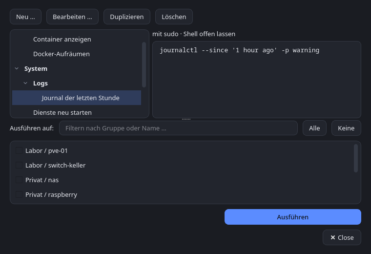 |

| Integriertes Terminal mit Kacheln (hell) | Integriertes Terminal mit Kacheln (dunkel) |
| ---------------------------------------- | ------------------------------------------ |
| 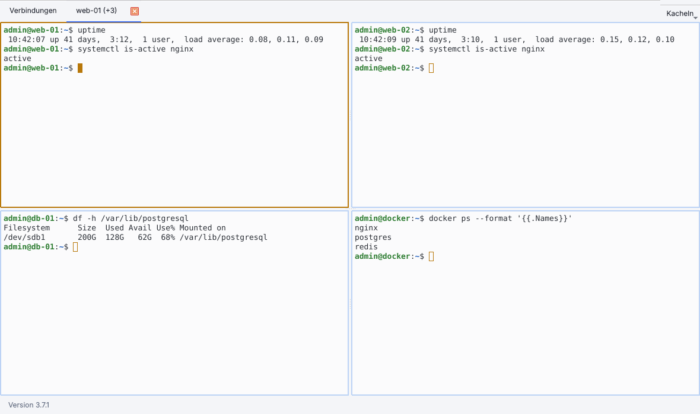 | 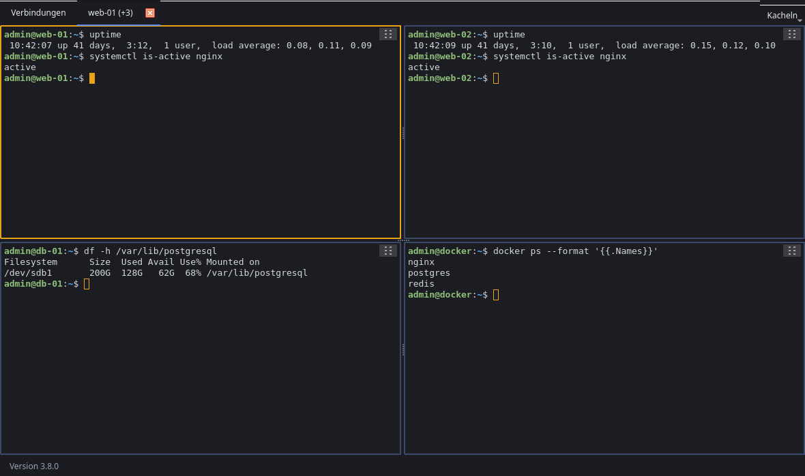 |

| „Eingabe an alle Kacheln senden“ (roter Rand) | Einstellungen |
| --------------------------------------------- | ------------- |
| 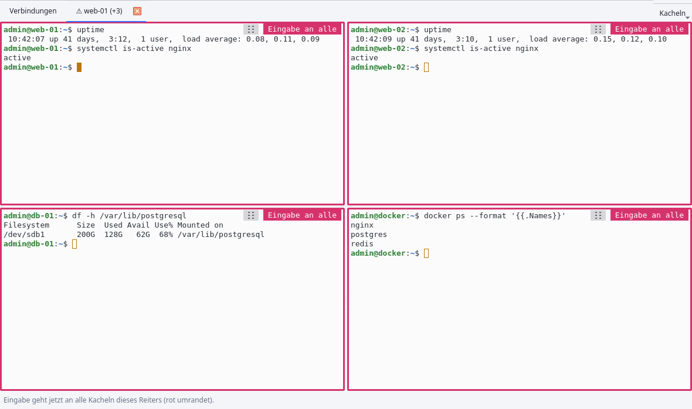 | 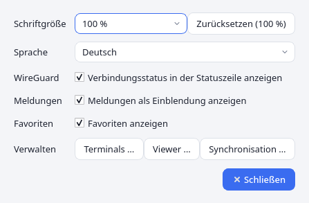 |

Die Bilder zeigen Beispieldaten (erfundene Hosts) und wurden mit dem Qt-Plattform-Plugin „offscreen“ erzeugt; echte Fenster können je nach Desktop in Rahmen und Schrift abweichen.

## Dokumentation

Die ausführliche Anleitung steht im Ordner [`docs/`](docs/):


| Seite                                                       | Inhalt                                                                                   |
| ----------------------------------------------------------- | ---------------------------------------------------------------------------------------- |
| [Verbindungen verwalten](docs/verbindungen.md)              | Darstellung, Gruppen, Favoriten und Schnellstarter, Farben und Tags, offene Verbindungen |
| [Zugangsdaten und sudo](docs/zugangsdaten.md)               | Identitäten, SSH-Schlüssel, sudo, Passwörter                                          |
| [Terminals und Snippets](docs/terminals-snippets.md)        | Terminals konfigurieren, integriertes Terminal mit Kacheln, Zwischenablage-Verlauf, Verbindungsfehler und Host-Schlüssel, Snippets |
| [Dateien und Tunnel](docs/dateien-tunnel.md)                | SFTP-Dateibrowser, Port-Weiterleitungen                                                  |
| [Fernzugriff (VNC und RDP)](docs/fernzugriff.md)            | Eingebauter VNC-Viewer, externe Viewer, Tunnel und Direktverbindung, Passwort            |
| [Docker, Proxmox, Cisco und WireGuard](docs/geraete.md)     | Container, Gäste, Switch-Ports, WireGuard-Anzeige                                       |
| [Synchronisation und Daten](docs/synchronisation.md)        | Abgleich über Git, Speicherort der Daten                                                |
| [Entwicklung: Bauen, Builds und Tests](docs/entwicklung.md) | Programm bauen, automatische Builds, Tests                                               |
| [Release-Ablauf](docs/release.md)                           | Von der Codeänderung zum installierten Paket (Manjaro)                                  |
