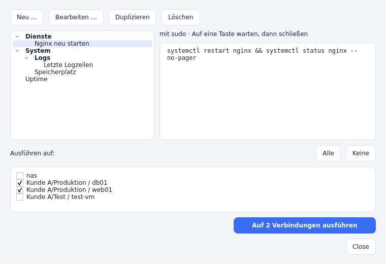
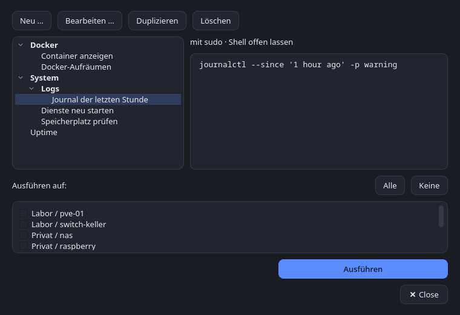
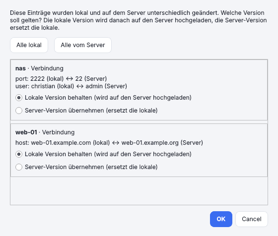
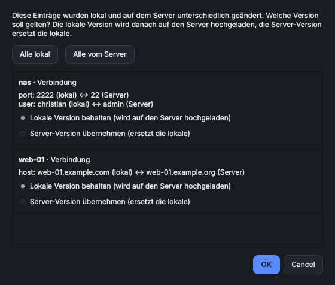

[](https://github.com/focmb/sesam/actions/workflows/build.yml)
[](https://github.com/focmb/sesam/releases/latest)
[](LICENSE)


<p align="center"></p>

# Sesam

SSH-Verbindungsmanager (Windows und Linux, Python + PySide6) zum Verwalten von SSH-Verbindungen.
Verbindungen werden in einem **frei konfigurierbaren Terminal** geöffnet.

*[English version: README.en.md](README.en.md)*

## Inhaltsverzeichnis

- [Funktionen](#funktionen)
- [Start](#start)
- [Aus dem Release-Archiv installieren (Linux)](#aus-dem-release-archiv-installieren-linux)
- [Screenshots](#screenshots)
- [Darstellung](#darstellung)
- [Im Anwendungsmenü / Dash installieren (Linux)](#im-anwendungsmenü--dash-installieren-linux)
- [Gruppen](#gruppen)
- [Farben und Tags](#farben-und-tags)
- [Terminals konfigurieren](#terminals-konfigurieren)
- [Identitäten](#identitäten)
- [SSH-Schlüssel](#ssh-schlüssel)
- [sudo](#sudo)
- [Passwörter](#passwörter)
- [Verbindungsfehler und geänderte Host-Schlüssel](#verbindungsfehler-und-geänderte-host-schlüssel)
- [Snippets](#snippets)
- [Dateien übertragen (SFTP)](#dateien-übertragen-sftp)
- [Docker-Container](#docker-container)
- [Proxmox](#proxmox)
- [Cisco-Geräte](#cisco-geräte)
- [WireGuard-Anzeige](#wireguard-anzeige)
- [Synchronisation über Git](#synchronisation-über-git)
- [Daten](#daten)
- [Programm bauen (Linux und Windows)](#programm-bauen-linux-und-windows)
- [Automatischer Build (Gitea Actions)](#automatischer-build-gitea-actions)
- [Automatischer Build (GitHub Actions)](#automatischer-build-github-actions)
- [Tests](#tests)

## Funktionen

- **Verbindungsverwaltung:** SSH-Verbindungen in verschachtelten Gruppen mit Drag & Drop, Farben, Tags, Suche und Mehrfachauswahl; Import aus `~/.ssh/config`.
- **Eigenes Terminal:** Jede Verbindung öffnet sich im Terminal deiner Wahl (Windows Terminal, PowerShell, cmd, PuTTY, GNOME Terminal, eigene Programme) über frei konfigurierbare Befehlsvorlagen, auch pro Verbindung verschieden.
- **Zugangsdaten:** Passwörter im Schlüsselbund des Betriebssystems, nicht in der Konfigurationsdatei. Identitäten bündeln Benutzer, Schlüssel und Passwort für viele Verbindungen.
- **SSH-Schlüssel in der App:** Ed25519/RSA erzeugen oder importieren, Fingerabdruck ansehen, per Klick auf Server installieren (wie `ssh-copy-id`) und Verbindungen zuweisen.
- **sudo:** Nach dem Login direkt zu root oder einem anderen Benutzer wechseln, auf Wunsch mit dem gespeicherten Passwort und ohne erneute Eingabe.
- **Snippets:** Gespeicherte Befehle (mit Kategorien) auf einem oder mehreren Hosts gleichzeitig ausführen, optional mit sudo, danach Shell offen lassen, auf eine Taste warten oder das Terminal schließen.
- **Dateien übertragen (SFTP):** Zweigeteilter Dateibrowser mit Drag & Drop, Fortschritt im Hintergrund, Umbenennen, Löschen und Ordner anlegen, ohne `sftp` oder `scp` auf dem Rechner.
- **Docker:** Container eines Hosts im Verbindungsbaum anzeigen, starten, stoppen, neu starten, löschen und per Doppelklick eine Shell im Container öffnen.
- **Proxmox:** VMs und LXC-Container im Baum, Shell in LXC und VM, Starten, Herunterfahren, Stoppen und Neustarten.
- **Cisco-Switches:** Ports im Baum mit Zustand, VLAN und Geschwindigkeit; ein- und ausschalten, Beschreibung ändern, Konfiguration speichern.
- **WireGuard-Anzeige (optional):** Die Statuszeile zeigt, ob der Rechner mit einem WireGuard-Tunnel verbunden ist (Tunnelname, verbunden, veraltet oder getrennt); ein Klick zeigt Einzelheiten.
- **Synchronisation über Git:** Verbindungen, Gruppen, Identitäten, Schlüssel und Snippets zwischen mehreren Geräten abgleichen; Passwörter und private Schlüssel nur verschlüsselt (AES-256-GCM).
- **Windows und Linux:** Gleiche Bedienung auf beiden Systemen, helles und dunkles Design, einstellbare Schriftgröße, Oberfläche auf Deutsch und Englisch.

## Start

```bash
python -m venv .venv
source .venv/bin/activate        # Windows: .venv\Scripts\activate
pip install -e .
sesam                            # oder: python -m sesam
```

Ohne Python-Umgebung: siehe „Aus dem Release-Archiv installieren“. Für einen Starter im Anwendungsmenü/Dash siehe „Im Anwendungsmenü / Dash installieren“.

## Aus dem Release-Archiv installieren (Linux)

Auf der [Release-Seite](https://github.com/focmb/sesam/releases) liegt zu jeder Version `sesam-<Version>-linux-x86_64.tar.gz`: ein fertig
gebautes Programm, das ohne installiertes Python läuft (gebaut auf Ubuntu 22.04). Nicht zu verwechseln mit dem Archiv „Source code (tar.gz)“,
das GitHub automatisch anbietet und das nur den Quelltext enthält.

**Voraussetzungen:** die üblichen Qt-Bibliotheken sowie `openssh-client` und `git`. Unter Debian/Ubuntu:

```bash
sudo apt install libxcb-cursor0 libegl1 openssh-client git
```

Optional vorher die Prüfsumme kontrollieren (Archiv und `SHA256SUMS` aus demselben Release im selben Ordner):

```bash
sha256sum -c --ignore-missing SHA256SUMS
```

**Variante A: mit Starter im Anwendungsmenü/Dash (empfohlen).** Das Skript `install.sh` liegt im Quelltext, nicht im Archiv. Es erwartet das
entpackte Programm im Ordner `dist/` des Repositorys:

```bash
git clone https://github.com/focmb/sesam.git && cd sesam
mkdir -p dist && tar -xzf ~/Downloads/sesam-<Version>-linux-x86_64.tar.gz -C dist
./packaging/linux/install.sh
```

Das Programm liegt danach in `~/.local/share/sesam-app`, der Befehl `sesam` in `~/.local/bin` (bei manchen Distributionen muss der Ordner erst
im `PATH` stehen), dazu kommen Starter und Icon. Für ein Update: im Repository `git pull`, `rm -rf dist/sesam`, das neue Archiv wie oben
entpacken und `install.sh` erneut ausführen. Entfernen mit `./packaging/linux/install.sh --uninstall`; die Konfiguration in `~/.config/sesam` bleibt erhalten.

**Variante B: nur entpacken und starten (ohne Menüeintrag).**

```bash
mkdir -p ~/opt && tar -xzf ~/Downloads/sesam-<Version>-linux-x86_64.tar.gz -C ~/opt
~/opt/sesam/sesam                                  # starten
ln -s ~/opt/sesam/sesam ~/.local/bin/sesam         # optional: Befehl „sesam“ im Terminal
```

Ein Update ist dasselbe noch einmal mit dem neuen Archiv (vorher `rm -rf ~/opt/sesam`). Fehlt beim Start eine Bibliothek, zeigt
`QT_DEBUG_PLUGINS=1 ~/opt/sesam/sesam`, welche. Unter Arch Linux/Manjaro ist das Pacman-Paket aus `packaging/aur` bequemer (siehe „Programm bauen“).

## Screenshots


| Dunkel | Verbindung bearbeiten |
| --- | --- |
|  |  |

| Dateibrowser (SFTP, hell) | Dateibrowser (SFTP, dunkel) |
| --- | --- |
|  |  |

| Snippets (hell) | Snippets (dunkel) |
| --- | --- |
|  |  |

Die Bilder zeigen Beispieldaten (erfundene Hosts) und wurden mit dem Qt-Plattform-Plugin „offscreen“ erzeugt; echte Fenster können je nach Desktop in Rahmen und Schrift abweichen.

## Darstellung

Der Dialog *Verbindung bearbeiten* ist in vier Reiter gegliedert: *Allgemein* (Name, Host, Gruppe, Farbe, Tags, Terminal, Notizen), *Zugang* (Identität, Benutzer, Port, Schlüssel, Passwort), *Erweitert* (Jump-Host, zusätzliche Optionen, Remote-Befehl, sudo) und *Baum-Erweiterungen* (Docker, Proxmox, Cisco). So passt er auch auf kleine Bildschirme.

Es gibt keine Menüleiste: Alle Aktionen (Verbinden, Dateien, Neue Verbindung, Neue Gruppe, Bearbeiten, Duplizieren, Löschen, Synchronisieren, Synchronisation, Identitäten, Schlüssel, Terminals)
stehen untereinander in einer Seitenleiste am rechten Rand (Strg+Q beendet das Programm, *Aus ~/.ssh/config importieren* steht im Rechtsklick-Menü der Verbindungsliste); die Tastenkürzel (Enter, Strg+N, F2, Entf, Strg+D, F5 …) gelten im ganzen Fenster.
*Duplizieren* legt eine Kopie an und öffnet sie sofort zum Bearbeiten, der Name ist markiert und lässt sich gleich überschreiben; bricht man ab, bleibt die Kopie bestehen.

Ganz unten in der Seitenleiste schalten drei Symbole zwischen **Hell** (Sonne), **Dunkel** (Mond) und **Wie das System** (Monitor) um (wirkt sofort, wird gespeichert).
Darunter öffnet der Knopf **Einstellungen** den Einstellungsdialog (Schriftgröße, Sprache und WireGuard-Anzeige, siehe unten).
Bei *Wie das System* folgt Sesam dem Hell/Dunkel-Wechsel des Betriebssystems, sofern Qt ihn meldet (Windows, macOS, Linux je nach Desktop);
andernfalls stellst du es manuell ein.

**Schriftgröße:** im Dialog *Einstellungen* (80 bis 200 % der Systemschrift), oder per Tastatur **Strg + Plus** (größer), **Strg + Minus** (kleiner) und **Strg + 0** (zurück auf 100 %).
Icons und Seitenleiste wachsen mit. Die Einstellung gilt sofort, wird gespeichert und bleibt lokal (wird nicht per Git synchronisiert).

**Sprache:** Sesam gibt es auf Deutsch und Englisch. Im Dialog *Einstellungen* wählst du *Systemvorgabe* (Deutsch, wenn das System auf Deutsch läuft, sonst Englisch), *Deutsch* oder *English*.
Die Sprache gilt nach dem nächsten Start von Sesam und wird lokal gespeichert (wird nicht per Git synchronisiert). Das gilt auch für den Befehlszeilenmodus (`sesam --connect`).
Die Quelltexte sind deutsch; `src/sesam/i18n.py` liefert über `tr("deutscher Text")` die englische Fassung aus `src/sesam/translations_en.py`. Neue Texte trägst du dort ein –
der Test `tests/test_i18n.py` schlägt fehl, solange ein Text im Katalog fehlt. Eine weitere Sprache braucht eine zweite Katalogdatei und einen Eintrag in `i18n.LANGUAGES`.

Das Erscheinungsbild (Farben, Abstände, Icons) kommt aus `src/sesam/gui/style.py`: ein gemeinsames Stylesheet für Hell und Dunkel, das aus einer
Farbtabelle (`TOKENS`) erzeugt wird. Farben änderst du dort an einer Stelle; Icons sind einfache Linienzeichnungen im gleichen Modul.
Sesam nutzt dafür überall den Qt-Stil „Fusion“, damit es unter Windows und Linux gleich aussieht.

## Im Anwendungsmenü / Dash installieren (Linux)

Ein Skript legt Sesam für deinen Benutzer an (ohne root): Starter im Anwendungsmenü bzw. Dash, Icon und den Befehl `sesam`.

```bash
./packaging/linux/install.sh --dev        # startet direkt aus dem Projektordner (.venv), immer aktueller Code
./packaging/linux/install.sh              # oder: aus dem gebauten Programm (dist/sesam, siehe „Programm bauen“ und „Aus dem Release-Archiv installieren“)
./packaging/linux/install.sh --uninstall  # entfernt alles wieder; ~/.config/sesam bleibt erhalten
```

Nach Änderungen am Code genügt bei `--dev` ein Neustart von Sesam; beim gebauten Programm musst du neu bauen und das Skript erneut ausführen.
Der Befehl `sesam` liegt in `~/.local/bin` (bei manchen Distributionen muss der Ordner erst im `PATH` stehen).

## Gruppen

Verbindungen lassen sich in verschachtelten Gruppen ordnen (Pfad mit „/“, z. B. `Kunde A/Produktion`).
- *Neue Gruppe …* (Strg+Umschalt+N, Seitenleiste oder Kontextmenü) legt auch leere Gruppen an; im Kontextmenü einer Gruppe: Untergruppe, Umbenennen/Verschieben, Löschen.
- Per **Drag & Drop** verschiebst du Verbindungen und ganze Gruppen; Ablegen auf freier Fläche = oberste Ebene.
- **Mehrfachauswahl:** Mit Strg- bzw. Umschalt-Klick (oder Strg+A) wählst du mehrere Verbindungen. Im Kontextmenü (Rechtsklick in die Auswahl) setzt du allen gemeinsam eine *Farbe* oder löschst sie auf einmal; mit *Entf* geht das Löschen ebenfalls. Per Drag & Drop wandern alle ausgewählten Verbindungen zusammen in die Zielgruppe. Gruppen in der Auswahl bleiben bei diesen Aktionen unberührt; Verbinden, Bearbeiten und Duplizieren wirken weiterhin auf den zuletzt angeklickten Eintrag.
- Eine Gruppe zu löschen entfernt keine Verbindungen, sie rücken in die übergeordnete Gruppe.
- Neue Verbindungen landen in der aktuell ausgewählten Gruppe. Das Suchfeld filtert auch nach Gruppen.
- **Spalten:** Ein Rechtsklick auf die Spaltenköpfe blendet *Ziel*, *Terminal*, *Tags* und *Betriebssystem* ein oder aus (der Name bleibt immer sichtbar). Die Auswahl bleibt lokal gespeichert. *Betriebssystem* ist zunächst ausgeblendet.
- **Betriebssystem des Hosts:** Beim ersten Verbinden fragt Sesam im Hintergrund über eine zweite SSH-Verbindung das Betriebssystem ab (`/etc/os-release`, macOS, `uname`, Windows `ver`, bei Cisco-Switches `show version | include ^Cisco IOS`) und speichert es bei der Verbindung, sodass es bei jedem Start in der Spalte steht. Ist die letzte Abfrage älter als 7 Tage, erneuert Sesam den Wert beim nächsten Verbinden (schlägt das fehl, bleibt der alte stehen). Unbekannte Host-Schlüssel übernimmt diese Abfrage nie selbst: Sie wartet, bis du im Terminal bestätigt hast. Verbindungen mit Jump-Host werden nicht abgefragt. Im Kontextmenü der Verbindung ermittelt *Betriebssystem ermitteln* den Wert erneut, auch mit Passwortabfrage.
- Auf- und Zugeklapptes merkt sich Sesam: Beim nächsten Start sind genau die Gruppen zu, die beim Beenden zu waren. Dieser Zustand (wie die Spaltenbreiten und die Fenstergröße, auch maximiert) bleibt lokal und wird nicht per Git synchronisiert.

## Farben und Tags

- **Farbe:** Verbindungen und Gruppen können eine von acht Farben bekommen; sie färbt das Symbol im Baum (die Zeile selbst bleibt unverändert, auch im dunklen Design gut lesbar).
  Bei Verbindungen wählst du sie im Bearbeiten-Dialog (*Farbe*) oder per Rechtsklick → *Farbe*, bei Gruppen per Rechtsklick → *Farbe*. Eine Gruppenfarbe wandert beim Umbenennen und Verschieben mit.
- **Tags:** Eine Verbindung kann mehrere Tags tragen (*Tags* im Bearbeiten-Dialog, mit Komma trennen, z. B. `prod, kunde-a`). Der Dialog schlägt bereits vergebene Tags vor.
  Der Baum zeigt sie in der Spalte *Tags*, und das Suchfeld findet sie wie Namen, Hosts und Gruppen. Groß-/Kleinschreibung spielt keine Rolle.
- Farben und Tags werden mit synchronisiert (Gruppenfarben in `groups.json`). Bei widersprüchlichen Änderungen derselben Gruppenfarbe gewinnt die lokale.
- Die Spaltenbreiten der Hauptansicht werden einmalig auf die Standardwerte zurückgesetzt, weil eine Spalte dazukam.

## Terminals konfigurieren

Unter *Terminals …* in der Seitenleiste legst du Terminals als Befehlsvorlage an und wählst ein Standardterminal.
Pro Verbindung kann ein abweichendes Terminal gewählt werden; im Kontextmenü gibt es „Verbinden mit …“.

| Platzhalter | Bedeutung |
|---|---|
| `{ssh_args}` | ssh-Befehl als einzelne Argumente |
| `{ssh_command}` | ssh-Befehl als ein String |
| `{title}` `{host}` `{user}` `{port}` `{destination}` | Verbindungsdaten |

Beispiele: `gnome-terminal --title {title} -- {ssh_args}`, `wt.exe new-tab --title {title} {ssh_args}`,
`cmd.exe /k {ssh_command}`, `putty.exe -ssh -P {port} {destination}`.

Beim ersten Start werden auf dem System gefundene Terminals vorbelegt.

Eigene Terminals (z. B. Ghostty) legst du über *Neu ▾ → Eigenes Terminal* an. Mit „Programm wählen …“ kannst du die
ausführbare Datei auswählen, falls sie nicht im `PATH` liegt (z. B. AppImage). Die Vorlagen für nicht installierte Terminals
findest du ebenfalls unter *Neu ▾*.

## Identitäten

Eine Identität bündelt **Benutzer, Schlüsseldatei und Passwort** und kann von beliebig vielen Verbindungen verwendet werden.
- Verwalten unter *Identitäten …* in der Seitenleiste oder direkt beim Anlegen einer Verbindung über *Identität → Neu …*.
- Wählst du in einer Verbindung eine Identität, ersetzt sie Benutzer, Schlüsseldatei und Passwort der Verbindung (die Felder sind dann gesperrt, die eigenen Werte bleiben erhalten und gelten wieder bei „Keine“).
- Das Passwort liegt im Schlüsselbund, einmal pro Identität. Ändert sich ein Passwort, wird es nur an einer Stelle angepasst. Das gilt auch für sudo.
- Eine Identität zu löschen entfernt sie auch aus allen Verbindungen, die sie nutzen (diese brauchen danach wieder eigene Zugangsdaten).

## SSH-Schlüssel

*Schlüssel …* in der Seitenleiste verwaltet Schlüssel direkt in Sesam – unter Windows und Linux gleich.
- **Erzeugen:** Ed25519 (empfohlen) oder RSA 4096, optional mit Passphrase. Das Format ist das normale OpenSSH-Format, `ssh-keygen` und Terminals verstehen es.
- **Importieren:** eine vorhandene private Schlüsseldatei einlesen (OpenSSH oder klassisches PEM). Liegt daneben eine `.pub`-Datei, wird sie für geschützte Schlüssel genutzt, sonst fragt Sesam einmal nach der Passphrase.
- **Ansehen:** Typ, Fingerabdruck (SHA256 wie bei `ssh-keygen -l`), Kommentar, Erstelldatum, öffentlicher Schlüssel und wer den Schlüssel verwendet. *Öffentlichen Schlüssel kopieren* legt die Zeile für `authorized_keys` in die Zwischenablage.
- **Auf Server installieren:** wie `ssh-copy-id`. Du wählst eine Verbindung, Sesam trägt den Schlüssel in `~/.ssh/authorized_keys` ein (Rechte werden gesetzt, doppelte Einträge vermieden). Die Anmeldung muss dafür einmalig klappen; bei Bedarf wird nach dem Passwort gefragt.
- **Zuweisen:** in Verbindung und Identität unter *Gespeicherter Schlüssel*. Er ersetzt dann die Schlüsseldatei und gilt für Terminal, SFTP und Docker. Eine Identität hat Vorrang vor der Verbindung.
- **Löschen:** entfernt den Schlüssel (privat und öffentlich) und hebt Zuweisungen auf. Auf Servern eingetragene öffentliche Schlüssel bleiben dort bestehen.
- **Speicherort:** der private Teil liegt als Datei (Rechte 0600) im Konfigurationsordner unter `keys/`, nicht im Schlüsselbund, weil `ssh -i` eine Datei braucht und der Windows-Speicher für große Schlüssel zu klein ist.
- **Synchronisation:** Name, Typ, Fingerabdruck und öffentlicher Schlüssel werden immer abgeglichen. Der **private Teil** wandert nur verschlüsselt und nur, wenn die Passwort-Synchronisation (mit Sync-Passwort) aktiv ist. Ohne sie zeigt Sesam auf anderen Geräten „privater Schlüssel auf diesem Gerät: nein“.

## sudo

Pro Verbindung kannst du *Mit sudo* aktivieren: nach dem Login wechselt die Sitzung direkt zu root oder einem anderen Benutzer
(`sudo -i` = Login-Shell, `sudo -s` = Shell mit bisheriger Umgebung; Zielbenutzer optional). Zusätzlich gibt es im Kontextmenü
*Als root verbinden (sudo -i)* für einen einmaligen Wechsel, ohne die Verbindung zu ändern.

**sudo ohne erneute Eingabe:** Ist für die Verbindung ein Passwort gespeichert und *Gespeichertes Passwort auch für sudo verwenden*
aktiv (Standard), wird es für sudo automatisch genutzt. Es wird nie als Kommandozeilenargument übergeben, sondern verschlüsselt
als Umgebungsvariable `LC_SSHV_PW` (`ssh -o SendEnv=…`) in die Sitzung gereicht. Auf dem Server prüft `sudo -S -v` es genau
einmal, danach startet `sudo -i`/`sudo -s` ohne Abfrage.
- Der Server muss `LC_*` per `AcceptEnv` zulassen (Debian/Ubuntu: Standard). Sonst, oder bei falschem Passwort, fragt sudo wie gewohnt im Terminal.
- Das Passwort ist in der Sitzungsumgebung kurz für den eigenen Benutzer und root auf dem Server lesbar. Für sudo selbst wird die Variable entfernt.
- Funktioniert auch bei Anmeldung per Schlüssel: Das gespeicherte Passwort wird dann nur für sudo gebraucht.

## Passwörter

Pro Verbindung kann ein Passwort hinterlegt werden. Es wird im Schlüsselbund des Betriebssystems gespeichert
(Secret Service/GNOME Keyring/KWallet unter Linux, Anmeldeinformationsverwaltung unter Windows), **nicht** in `config.json`.
Beim Verbinden startet das Terminal `ssh` über einen kleinen Wrapper, der das Passwort per `SSH_ASKPASS` übergibt
(OpenSSH ≥ 8.4). Hinweise:
- Auf Passwortabfragen wird automatisch geantwortet, auf andere Abfragen (Passphrase, 2FA-Code) nicht.
- Unbekannte Hosts werden automatisch in `known_hosts` aufgenommen (`StrictHostKeyChecking=accept-new`), geänderte Schlüssel werden weiterhin abgelehnt. Setzt du die Option selbst unter „Zusätzliche Optionen“, hat sie Vorrang.

## Verbindungsfehler und geänderte Host-Schlüssel

Jede Verbindung startet im Terminal über einen kleinen Wrapper (auch ohne gespeichertes Passwort), der `ssh` als Unterprozess ausführt.
- **Verbindung klappt nicht** (Server abgeschaltet, Zeitüberschreitung, Anmeldung abgelehnt …): Das Terminal bleibt mit der Meldung von `ssh` offen, bis du Enter drückst. Normal beendete Sitzungen schließen sich wie gewohnt.
- **Schlüssel des Servers hat sich geändert** (z. B. neuer Server mit gleicher IP): Nach der Meldung fragt der Wrapper, ob der alte Eintrag per `ssh-keygen -R` aus `known_hosts` entfernt und neu verbunden werden soll. Bei „j“ wird der neue Schlüssel übernommen, bei „N“ (Standard) bleibt alles unverändert. Der Eintrag sollte nur entfernt werden, wenn die Änderung erwartet war – sonst könnte es ein Angriff sein.
- Terminal-Vorlagen ohne `{ssh_args}`/`{ssh_command}` (z. B. PuTTY) starten die Verbindung selbst und laufen nicht über den Wrapper.

## Snippets

*Snippets …* (Strg+Umschalt+S, Seitenleiste) speichert Befehle, die im Terminal auf einem oder mehreren Hosts laufen.
- **Anlegen:** Name, Befehl (auch mehrzeilig, z. B. `df -h && free -m`), optional eine **Kategorie** (Unterordner mit „/“, z. B. `Docker/Logs`) und eine Notiz. Der Befehl gilt für alle Verbindungen.
- **Ausführen:** Rechtsklick auf eine Verbindung → *Snippet ausführen* (die Kategorien erscheinen als Untermenüs) oder im Snippet-Fenster unten die Ziele ankreuzen. Mit Mehrfachauswahl (Strg-/Umschalt-Klick) läuft das Snippet auf allen ausgewählten Verbindungen; je Verbindung öffnet sich ein Terminal, vorher fragt Sesam nach. Ein Fehler bei einem Ziel (z. B. fehlender Schlüssel) stoppt die anderen nicht.
- **Mit sudo:** Nur der Befehl läuft per `sudo -i` (Zielbenutzer der Verbindung, sonst root). Das gespeicherte Passwort wird wie bei *Mit sudo* der Verbindung genutzt. Eine danach offene Shell gehört wieder dem normalen Benutzer.
- **Danach:** *Shell offen lassen* (Standard), *Auf eine Taste warten* oder *Terminal sofort schließen*.
- Der Befehl läuft in `sh -c` auf dem Zielsystem. „Remote-Befehl“ und „Mit sudo“ der Verbindung werden für das Snippet ersetzt.
- **Synchronisation:** Snippets liegen im Git-Repository (`snippets/`) im Klartext und kommen auf alle Geräte. Schreibe keine Passwörter oder Tokens in Befehle.

## Dateien übertragen (SFTP)

*Dateien (SFTP)* (F4, Seitenleiste oder Kontextmenü einer Verbindung) öffnet einen Dateibrowser: links dein Rechner, rechts der Server.
- **Übertragen:** Dateien und Ordner per **Drag & Drop** zwischen den Seiten ziehen, mit den Knöpfen *Hochladen* / *Herunterladen* oder über das Kontextmenü.
  Auf der Serverseite kannst du auch Dateien direkt aus dem Dateimanager ablegen; wirfst du auf einen Ordner, landen sie darin.
- **Fortschritt:** Jede Übertragung läuft im Hintergrund mit eigenem Fortschrittsbalken und lässt sich abbrechen (eine halb übertragene Datei wird dabei entfernt). Mehrere Übertragungen laufen gleichzeitig.
- **Vorhandene Dateien:** Gibt es am Ziel schon gleichnamige Einträge, fragt Sesam: *Überschreiben*, *Überspringen* oder *Abbrechen*. Die Wahl gilt für die Einträge der obersten Ebene; Dateien in übertragenen Ordnern werden bei *Überschreiben* ersetzt.
- **Verwalten:** *Neuer Ordner*, *Umbenennen* (F2) auf beiden Seiten, *Löschen* (Entf) auf dem Server (nach Rückfrage, Ordner samt Inhalt). Pfadzeile (Strg+L), „Eine Ebene höher“, Persönlicher Ordner und Aktualisieren (F5) gibt es je Seite; die Spalten lassen sich sortieren.
- **Anmeldung:** wie beim Terminal, also mit Benutzer, Schlüsseldatei oder dem im Schlüsselbund gespeicherten Passwort (auch über eine Identität). Ist nichts hinterlegt oder wird es abgelehnt, fragt Sesam einmal nach; dieses Passwort gilt nur für das geöffnete Fenster und wird nicht gespeichert.
  Unbekannte Hosts werden wie bei ssh in `known_hosts` aufgenommen, geänderte Schlüssel abgelehnt.
- **Grenzen:** Verbindungen mit **Jump-Host** werden noch nicht unterstützt, „Zusätzliche Optionen“ und *Mit sudo* gelten nicht für die Dateiübertragung (es wird mit dem Benutzer der Verbindung gearbeitet, nicht als root).
  Verknüpfungen auf Ordner werden beim Herunterladen nicht verfolgt (Schutz vor Schleifen), Verknüpfungen auf Dateien als Datei übertragen.
- Die Übertragung nutzt die Python-Bibliothek *paramiko*, braucht also kein `sftp`/`scp` auf dem Rechner.

## Docker-Container

Läuft auf einem Host Docker, kannst du direkt in einen Container verbinden. In der Verbindung (*Bearbeiten*, Reiter *Baum-Erweiterungen*) den Haken
**Docker-Container dieses Hosts im Verbindungsbaum anzeigen** setzen; optional lassen sich Standard-Shell und -Benutzer für die Container festlegen.
- **Im Baum:** Der Host bekommt einen Pfeil. Beim Aufklappen fragt Sesam den Host per SSH nach seinen Containern (`docker ps -a`) und zeigt sie als Unterelemente
  (Name, Image, Status). Gestoppte Container erscheinen ausgegraut. Erst beim Aufklappen wird verbunden; *Container aktualisieren* (Kontextmenü) lädt neu.
- **Steuern:** Im Kontextmenü eines Containers gibt es *Starten*, *Stoppen*, *Neustarten* und *Löschen …* (`docker start`, `stop`, `restart`, `rm`).
  Stoppen, Neustarten und Löschen fragen vorher nach. Löschen entfernt nur den Container, nicht seine Volumes; ein noch laufender Container wird dabei beendet (`docker rm -f`).
  Danach lädt Sesam die Liste neu. Eine Shell lässt sich nur in laufende Container öffnen.
- **Verbinden:** Doppelklick oder Enter öffnet im Terminal eine Shell im Container (`docker exec -it`). Ohne feste Shell nimmt Sesam `bash`, sonst `sh`.
  *Verbinden als …* fragt Shell und Benutzer (z. B. `root`) für diesen einen Aufruf ab; *Verbinden mit …* wählt ein anderes Terminal.
- **Anmeldung:** Passwort und Schlüssel der Verbindung werden wie beim Terminal und bei SFTP verwendet. Ist keins gespeichert, fragt Sesam einmal nach
  (das Passwort bleibt nur im Speicher). Verbindungen über einen Jump-Host zeigen die Container noch nicht an.
- Der Docker-Benutzer braucht Zugriff auf den Docker-Socket (Gruppe `docker`); `sudo docker` wird nicht verwendet. Die Einstellungen werden mit synchronisiert,
  die Container selbst nicht.

## Proxmox

Ist ein Host ein Proxmox-VE-Server, zeigt Sesam seine Gäste im Baum. In der Verbindung (*Bearbeiten*, Reiter *Baum-Erweiterungen*) den Haken
**Proxmox-Gäste (VMs und LXC) dieses Hosts im Verbindungsbaum anzeigen** setzen (ersetzt die Docker-Anzeige); optional den Benutzer für VMs eintragen (Standard `root`).
- **Im Baum:** Beim Aufklappen fragt Sesam den Host per SSH als `root` mit `pvesh` nach allen VMs und LXC-Containern (auch anderer Cluster-Knoten). Laufende Gäste sind farbig, gestoppte grau; Vorlagen werden ausgeblendet.
- **LXC-Container:** Doppelklick öffnet im Terminal `pct enter <ID>` über den Host (bei Gästen anderer Knoten per SSH über diesen Knoten).
- **VMs:** Sesam erfragt die IP-Adresse über den QEMU-Gast-Agent und verbindet vom Proxmox-Host aus per SSH in die VM. Dafür muss der Agent in der VM laufen.
- **Ein-/Ausschalten:** Rechtsklick → *Starten*, *Herunterfahren*, *Stoppen (hart)*, *Neustarten*. Stoppen und Neustarten fragen vorher nach; danach lädt Sesam den Status neu.
- Dateibrowser und Jump-Hosts funktionieren wie bei Docker nur für den Host selbst. Die Einstellungen werden mit synchronisiert, die Gäste selbst nicht.

## Cisco-Geräte

Für Switches mit Cisco IOS, IOS-XE oder NX-OS zeigt Sesam die Ports im Baum. In der Verbindung (*Bearbeiten*, Reiter *Baum-Erweiterungen*) den Haken
**Ports dieses Cisco-Geräts … im Verbindungsbaum anzeigen** setzen (ersetzt die Docker- und Proxmox-Anzeige). Der Benutzer braucht Privilegstufe 15.
- **Im Baum:** Beim Aufklappen öffnet Sesam per SSH eine Shell auf dem Gerät und liest `show interfaces status`. Jeder Port zeigt Zustand (*verbunden*, *notconnect*, *aus*, *err-disabled* …), Beschreibung, VLAN und Geschwindigkeit.
- **Ein-/Ausschalten:** Rechtsklick → *Port ausschalten* (`shutdown`, mit Rückfrage) bzw. *Port einschalten* (`no shutdown`).
- **Beschreibung:** Rechtsklick → *Beschreibung ändern …* setzt `description`; leer entfernt sie.
- **Speichern:** *Konfiguration speichern* (am Gerät oder an einem Port) schreibt die laufende Konfiguration dauerhaft (`write memory`, auf NX-OS `copy running-config startup-config`). Änderungen an Ports wirken sofort, bleiben aber ohne Speichern nur bis zum Neustart des Geräts.
- Doppelklick auf einen Port öffnet das Gerät im Terminal. Wie bei Docker und Proxmox gehen Dateibrowser und Jump-Hosts nur für das Gerät selbst.

## WireGuard-Anzeige

Wer WireGuard nutzt, schaltet die Anzeige unter **Einstellungen › WireGuard** ein. Standardmäßig ist sie aus: Sesam fragt dann nichts ab und zeigt nichts an.

Unten rechts in der Statuszeile zeigt Sesam, ob dieser Rechner mit einem WireGuard-Tunnel verbunden ist, zum Beispiel `WireGuard · VZS · verbunden`. Der Tunnelname ist der Name der WireGuard-Schnittstelle (Linux) bzw. des Tunnels (Windows).

| Anzeige | Bedeutung |
|---|---|
| grün, *verbunden* | Ein Tunnel ist aktiv. |
| gelb, *veraltet* | Ein Tunnel ist aktiv, aber der letzte Handshake ist älter als drei Minuten. Der Tunnel hängt eventuell. |
| grau, *getrennt* | Es ist kein Tunnel aktiv. |
| gestrichelt, *nicht verfügbar* | Der Zustand lässt sich auf diesem System nicht ermitteln. |

Ein Klick auf die Anzeige zeigt Einzelheiten: Endpunkt, Tunnel-Adresse, erlaubte IPs, letzter Handshake und Datenmenge. Die Datenmenge liest Sesam ohne Administratorrechte aus den Zählern der Schnittstelle (Linux) bzw. des Netzwerkadapters (Windows). Endpunkt und Handshake liefert WireGuard (`wg show`) nur mit Administratorrechten und nur, wenn das Programm `wg` installiert ist (Paket `wireguard-tools`). Ohne sie erkennt Sesam nur, *dass* ein Tunnel läuft, und zeigt „veraltet“ nie an.

**sudo-Passwort (Linux, optional):** Beim Einschalten der Anzeige fragt Sesam nach dem sudo-Passwort. Mit gültigem Passwort liest Sesam Endpunkt und Handshake per `sudo wg show` (höchstens alle 30 Sekunden; der private Schlüssel wird nie abgefragt). Das Passwort wird nur über die Standardeingabe an sudo übergeben und im Schlüsselbund des Systems gespeichert; beim Ausschalten wird es gelöscht. Bleibt das Feld leer, wird abgebrochen oder ist das Passwort falsch, zeigt Sesam die einfache Anzeige; ein abgelehntes Passwort probiert Sesam nicht erneut, damit sudo den Zugang nicht sperrt. Bei mehreren Tunneln steht der erste Name mit Zusatz, etwa `VZS +1`.

Der Zustand wird alle 5 Sekunden im Hintergrund geprüft (Windows: alle 15 Sekunden). Linux: Sesam liest `/sys/class/net`. Windows: Sesam fragt per PowerShell die Netzwerkadapter „WireGuard Tunnel“ ab. Sesam baut selbst keine Tunnel auf und trennt keine.

## Synchronisation über Git

*Synchronisation …* in der Seitenleiste gleicht Verbindungen, Gruppen, Identitäten, Schlüssel und Snippets über ein Git-Repository ab (Terminals und
Fensterbreiten bleiben pro Gerät). Das Tool nutzt das installierte `git`. Die Anmeldung läuft im Hintergrund ohne Rückfragen:
- **SSH-Schlüssel** (`git@server:…`): wie sonst auch mit `git`.
- **Benutzername und Passwort bzw. Token** (`https://…`): im Dialog unter *Benutzername* und *Passwort / Token* eintragen. Das Passwort liegt im Schlüsselbund
  des Systems (nicht in der Konfigurationsdatei) und wird git nur über die Umgebung des Prozesses übergeben, nie in der Befehlszeile oder in der URL.
  Bei GitHub, GitLab und Gitea ist statt des Kontopassworts meist ein Zugriffstoken nötig. Löschst du den Benutzernamen, entfernt Sesam auch das gespeicherte Passwort.
- **Bereits gespeicherte Git-Zugangsdaten:** bleibt der Benutzername leer, gelten die Einstellungen von `git` (z. B. `git credential`-Helfer; einmal vorher per *Verbindung testen* oder `git ls-remote` anmelden).

- **Automatisch:** beim Start und kurz nach jeder Änderung. *F5* bzw. *Jetzt synchronisieren* löst den Abgleich manuell aus; der Status steht rechts unten.
- **Repository-Aufbau:** eine JSON-Datei pro Eintrag (`connections/`, `identities/`, `ssh_keys/`, `snippets/`), `groups.json`, `meta.json`. Das Repository darf privat sein, ist aber für Klartext-Daten wie Hostnamen und Benutzer sichtbar.
- **Passwörter** werden nur verschlüsselt abgelegt (scrypt + AES-256-GCM) und auf jedem Gerät in den Schlüsselbund geschrieben. Das **Sync-Passwort** legst du auf dem ersten Gerät fest und gibst es auf jedem weiteren ein. Es lässt sich nicht wiederherstellen und auch nicht ohne Weiteres ändern. Ohne Passwort-Sync bleiben vorhandene verschlüsselte Einträge im Repository erhalten.
- **Manipulationsschutz:** Mit Sync-Passwort wird jeder Eintrag zusätzlich signiert (HMAC-SHA-256). Einträge, die jemand direkt im Repository ändert (z. B. Host oder `ProxyCommand`), lehnt Sesam ab, behält die lokale Version, schreibt sie korrekt signiert zurück und meldet „abgelehnt“. Bestehende Repositories werden beim ersten Abgleich mit Sync-Passwort automatisch umgestellt – dafür auf allen Geräten aktualisieren. Geräte ohne Sync-Passwort können nicht signieren; ihre Änderungen werden von Geräten mit Passwort abgelehnt. Nicht abgedeckt: das Löschen von Einträgen und das Zurückspielen älterer, gültig signierter Stände.
- **Zusammenführen:** je Eintrag ein Dreiwege-Vergleich mit dem Stand des letzten Abgleichs. Änderungen an verschiedenen Einträgen werden kombiniert, Löschungen übernommen. Wurde derselbe Eintrag auf zwei Geräten unterschiedlich geändert, fragt Sesam, welche Version gelten soll: die lokale (wird danach auf den Server hochgeladen) oder die Server-Version (ersetzt die lokale). Es entstehen keine Kopien. Mit *Abbrechen* wird der Abgleich ohne Änderung beendet und beim nächsten Mal erneut gefragt.


  | Hell | Dunkel |
  |---|---|
  |  |  |

- **Doppelte Einträge:** Dieselbe Verbindung (gleicher Name, Host, Port, Benutzer und Gruppe) oder Identität (Name und Benutzer), die auf zwei Geräten getrennt angelegt wurde (z. B. durch *Aus ~/.ssh/config importieren* auf beiden), erkennt Sesam beim Abgleich als einen Eintrag: Die ID vom Server gilt, das lokale Passwort wandert mit, es entsteht keine zweite Verbindung. Unterscheiden sich die Einträge in weiteren Feldern, fragt Sesam wie bei einem Konflikt. Das gilt nur für Einträge, die beide Seiten noch nicht aus einem früheren Abgleich kennen. Bereits vorhandene Duplikate entfernt *Doppelte Verbindungen zusammenführen …* im Kontextmenü der Liste (je Gruppe bleibt eine, bevorzugt die mit gespeichertem Passwort).
- Wird eine Identität oder ein Schlüssel gelöscht, verlieren Verbindungen, die sie nutzen, den Verweis.
- Leeres Repository anlegen (z. B. bei GitHub/GitLab/Gitea) genügt, das Tool erstellt den Branch selbst.

## Daten

Konfiguration: `~/.config/sesam/config.json` (Linux), `%APPDATA%\sesam\config.json` (Windows).
Passwörter stehen nie in dieser Datei, sondern im Schlüsselbund des Betriebssystems; ohne gespeichertes Passwort läuft die Anmeldung über ssh (Schlüssel, Agent, Abfrage im Terminal).

Ist `config.json` beschädigt (kein gültiges JSON o. Ä.), löscht Sesam sie nicht: Die Datei wird als `config.json.defekt-<Datum>-<Uhrzeit>` daneben gesichert,
Sesam zeigt eine Meldung mit dem Grund und startet mit leerer Konfiguration. Du kannst die Sicherung reparieren und als `config.json` zurückkopieren.
Mit aktiver Git-Synchronisation richtest du sie wieder ein; die Verbindungen kommen dann aus dem Repository zurück. Kann die Datei nicht gelesen oder nicht gesichert werden,
startet Sesam nicht und ändert nichts.

Alte Daten aus der früheren Version („ssh_verwaltung“) werden beim ersten Start automatisch übernommen: der Konfigurationsordner wird umbenannt, Passwörter ziehen im Schlüsselbund um.

## Programm bauen (Linux und Windows)

Mit PyInstaller entsteht ein Programmordner, der ohne installiertes Python läuft. Gebaut wird auf dem jeweiligen Zielsystem
(Linux auf Linux, Windows auf Windows; Cross-Kompilieren geht nicht):

```bash
python -m venv .venv && source .venv/bin/activate      # Windows: .venv\Scripts\activate
pip install -e . pyinstaller
python packaging/build.py
```

Ergebnis in `dist/`: der Ordner `sesam/` und ein Archiv (`sesam-<Version>-linux-x86_64.tar.gz` bzw. `…-windows-x86_64.zip`).
- **Linux:** `sesam/sesam` starten. Zielsysteme brauchen die üblichen Qt-Bibliotheken, bei Ubuntu/Debian z. B. `libxcb-cursor0` und `libegl1`
  (`QT_DEBUG_PLUGINS=1 ./sesam` zeigt, was fehlt). Gebaut wird gegen die glibc des Build-Systems; für möglichst viele Systeme auf einer älteren
  Distribution bauen (getestet: Ubuntu 22.04).
- **Debian/Ubuntu-Paket:** `python packaging/build_deb.py` (nach `build.py`) erzeugt `dist/sesam_<Version>_amd64.deb`. Installieren mit
  `sudo apt install ./sesam_<Version>_amd64.deb`: Das Programm liegt in `/opt/sesam`, der Befehl `sesam` in `/usr/bin`, dazu Starter und Icon
  für das Anwendungsmenü; `apt` zieht die nötigen Qt-Bibliotheken, `openssh-client` und `git` nach. Entfernen mit `sudo apt remove sesam`
  (die Konfiguration in `~/.config/sesam` bleibt). Das Paket entsteht auf Debian/Ubuntu (braucht `dpkg-deb`); für möglichst viele Systeme
  auf Ubuntu 22.04 bauen.
- **Arch Linux / Manjaro:** `packaging/aur/PKGBUILD` baut Sesam als Pacman-Paket aus dem Quelltext-Tarball des Tags (GitHub-Spiegel
  `github.com/focmb/sesam`). Bauen und installieren mit `cd packaging/aur && makepkg -si`; `-s` holt fehlende Abhängigkeiten
  (`pyside6`, `python-paramiko` usw.), `-i` installiert das Paket. Entfernen mit `sudo pacman -R sesam` (die Konfiguration in
  `~/.config/sesam` bleibt). Das Paket ist bewusst nicht im AUR veröffentlicht. Bei einer neuen Version: Tag setzen und pushen,
  in `PKGBUILD` `pkgver` anpassen, `updpkgsums` ausführen und `makepkg --printsrcinfo > .SRCINFO` erneuern.
- **Release-Dateien:** Prüfsummen für den Release: `cd dist && sha256sum *.tar.gz *.deb > SHA256SUMS`.
- **Windows:** `sesam\sesam.exe` starten (Fenster ohne Konsole). Der Ordner enthält zusätzlich `sesam-cli.exe`; der ssh-Wrapper (Passwort/sudo)
  braucht eine Konsole und nutzt diese Variante automatisch. Voraussetzungen: OpenSSH-Client (Windows-Feature) und Git. Unsignierte Programme
  löst SmartScreen u. U. eine Warnung aus.
  Das Icon der `.exe` liegt als `packaging/windows/sesam.ico` im Repository; bei geändertem Programm-Icon neu erzeugen mit `python packaging/make_icon.py`.
- Es ist bewusst keine Ein-Datei-Variante: der Wrapper startet Sesam bei jeder Verbindung erneut, Entpacken würde jedes Mal dauern.

## Automatischer Build (Gitea Actions)

`.gitea/workflows/build.yml` läuft bei jedem Tag `v*` (z. B. `git tag v1.2.0 && git push --tags`) und auf Knopfdruck
(*Actions → Build → Run workflow*). Der Linux-Job installiert die Qt-Systembibliotheken, führt die Tests aus und baut mit
`packaging/build.py` und `packaging/build_deb.py`; `.tar.gz`, `.deb` und `SHA256SUMS` hängen als Artefakt `sesam-linux` am Lauf
(von dort lassen sie sich herunterladen und als Release anhängen).

Voraussetzung ist ein Gitea-Runner (`act_runner`, z. B. als Container neben Gitea) mit dem Label `ubuntu-22.04`,
etwa `ubuntu-22.04:docker://catthehacker/ubuntu:act-22.04`. Der Windows-Job steht auskommentiert im Workflow, bis ein Windows-Runner
(Label `windows`, mit Python und Git) existiert; bis dahin wird Windows von Hand gebaut (siehe oben).

## Automatischer Build (GitHub Actions)

Im GitHub-Spiegel (`github.com/focmb/sesam`) baut `.github/workflows/build.yml` mit GitHub-Runnern, eigene Runner sind nicht nötig.
Der Workflow läuft bei jedem Push auf `main`, bei jedem Tag `v*` und auf Knopfdruck (*Actions → Build → Run workflow*):

- **Linux** (Ubuntu 22.04): Tests, dann `sesam-<Version>-linux-x86_64.tar.gz` und `sesam_<Version>_amd64.deb`.
- **Windows:** `sesam-<Version>-windows-x86_64.zip` mit `sesam\sesam.exe` (mit Tests).
- **Release:** Bei einem Tag legt der Workflow auf GitHub ein Release mit allen Dateien und `SHA256SUMS` an. Bei „Run workflow“ liegen
  die Dateien nur als Artefakte (`sesam-linux`, `sesam-windows`) am Lauf.

Ablauf einer neuen Version: Version in `pyproject.toml` und `src/sesam/__init__.py` erhöhen, committen, `git tag -a v<Version> -m "Version <Version>"`
und `git push origin main --follow-tags`. Der Gitea-Spiegel überträgt Commits und Tag nach GitHub, dort startet der Build.
Der Workflow in `.gitea/workflows/` bleibt unabhängig davon bestehen.

## Tests

```bash
PYTHONPATH=src python -m unittest discover -s tests      # oder: python -m pytest
```

Die GUI-Tests laufen ohne Bildschirm (`QT_QPA_PLATFORM=offscreen` wird gesetzt) und werden übersprungen, wenn PySide6 oder die
Qt-Systembibliotheken fehlen. Die Sync-Tests brauchen `git`.
Die Paket-Tests (`test_packaging.py`) brauchen `dpkg-deb` und werden sonst übersprungen.
Die SFTP-Tests (`test_sftp.py`, `test_sftp_gui.py`) starten dafür einen kleinen SSH/SFTP-Server im Testprozess (nur auf `127.0.0.1`, mit
`paramiko`) und werden übersprungen, wenn `paramiko` fehlt. Dasselbe gilt für die Docker-Tests (`test_docker.py`, `test_docker_gui.py`); der Testserver
antwortet dort auf `docker ps`. Ebenso `test_proxmox.py` (antwortet auf `pvesh`) und `test_cisco.py` (simulierter Switch mit Shell).
