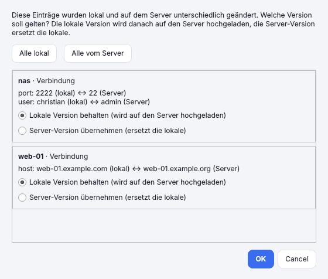
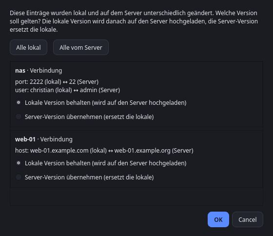

# Synchronization and data

← [Back to the README](../../README.en.md) · *[Deutsche Fassung](../synchronisation.md)*

## Synchronization via Git

*Settings › Synchronization …* syncs connections, groups, identities, keys and snippets through a Git repository (terminals and
window widths stay per device). The tool uses the installed `git`. Login runs in the background without prompts:
- **SSH key** (`git@server:…`): as usual with `git`.
- **Username and password or token** (`https://…`): enter them in the dialog under *Username* and *Password / token*. The password lives in the system keyring
  (not in the configuration file) and is passed to git only through the process environment, never on the command line or in the URL.
  For GitHub, GitLab and Gitea an access token is usually needed instead of the account password. If you delete the username, Sesam also removes the saved password.
- **Git credentials already saved:** if the username stays empty, the `git` settings apply (e.g. `git credential` helpers; log in once beforehand via *Test connection* or `git ls-remote`).

- **Automatic:** at startup and shortly after every change. *F5* or *Sync now* triggers the sync manually; the status is shown at the bottom right.
- **Repository layout:** one JSON file per entry (`connections/`, `identities/`, `ssh_keys/`, `snippets/`), `groups.json`, `meta.json`. The repository may be private, but plain-text data such as host names and users is visible in it.
- **Passwords** are stored only encrypted (scrypt + AES-256-GCM) and written to the keyring on every device. You set the **sync password** (at least 12 characters, scrypt with N=2¹⁷ for new repositories) on the first device and enter it on every further one. It cannot be recovered and cannot easily be changed. Without password sync, existing encrypted entries in the repository are kept.
- **Tamper protection:** With a sync password every entry is also signed (HMAC-SHA-256). Entries changed directly in the repository (e.g. host or `ProxyCommand`) are rejected: Sesam keeps the local version, writes it back correctly signed and reports “rejected”. Existing repositories are converted automatically on the first sync with a sync password – update all devices for this. Devices without a sync password cannot sign; their changes are rejected by devices with a password. Not covered: deleting entries and replaying older, validly signed states.
- **Merging:** a three-way comparison per entry against the state of the last sync. Changes to different entries are combined, deletions are applied. If the same entry was changed differently on two devices, Sesam asks which version to use: the local one (uploaded to the server afterwards) or the server version (replaces the local one). No copies are created. *Cancel* ends the sync without any change and asks again next time.

  | Light | Dark |
  |---|---|
  |  |  |

- **Duplicate entries:** the same connection (same name, host, port, user and group) or identity (name and user) that was created separately on two devices (e.g. by *Import from ~/.ssh/config* on both) is recognised as one entry during sync: the server’s ID wins, the local password moves along, and no second connection appears. If the entries differ in other fields, Sesam asks like for a conflict. This only applies to entries that neither side knows from an earlier sync. Duplicates that already exist are removed with *Merge duplicate connections …* in the list’s context menu (one per group is kept, preferably the one with a stored password).
- If an identity or key is deleted, connections that use it lose the reference.
- Creating an empty repository (e.g. on GitHub/GitLab/Gitea) is enough; the tool creates the branch itself.

## Data

Configuration: `~/.config/sesam/config.json` (Linux), `%APPDATA%\sesam\config.json` (Windows).
Passwords are never in this file but in the operating system’s keyring; without a saved password, login goes through ssh (key, agent, prompt in the terminal).

If `config.json` is damaged (not valid JSON or similar), Sesam does not delete it: the file is backed up next to it as `config.json.defekt-<date>-<time>`,
Sesam shows a message with the reason and starts with an empty configuration. You can repair the backup and copy it back as `config.json`.
With Git synchronization active, set it up again; the connections then come back from the repository. If the file can neither be read nor backed up,
Sesam does not start and changes nothing.

Old data from the earlier version (“ssh_verwaltung”) is taken over automatically at first start: the configuration folder is renamed, passwords move within the keyring.
