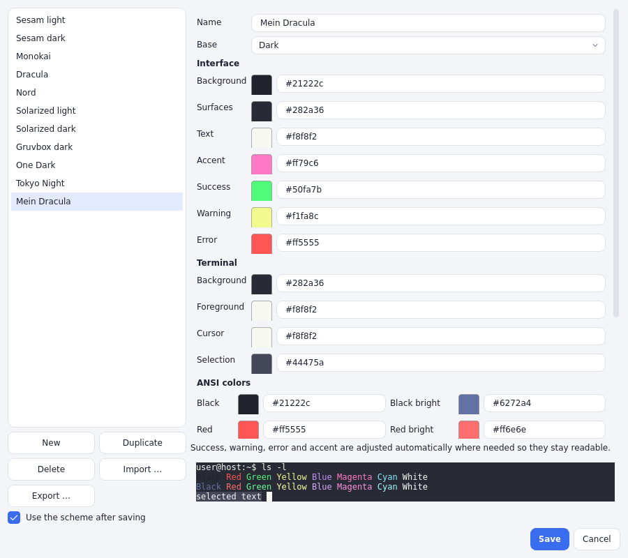

# Managing connections

← [Back to the README](../../README.md) · *[Deutsche Fassung](../verbindungen.md)*

## Appearance

The *Edit connection* dialog is split into four tabs: *General* (name, host, group, color, tags, terminal, notes), *Access* (identity, user, port, key, password), *Advanced* (jump host, extra options, remote command, sudo) and *Tree extensions* (Docker, Proxmox, Cisco). This keeps it usable on small screens.

There is no menu bar: all actions (Connect, Files, New connection, New group, Edit, Duplicate, Delete, Sync now, Synchronization, Identities, Keys, Terminals)
form a row of icons directly below the search box, above the connection list: Connect, Files (SFTP), Local terminal, New, Edit, Duplicate, Delete and Favorite as buttons, everything else (Quick launcher, New group, Sync, Identities, Keys, Snippets, Clipboard) in the **⋯** menu (“More actions”), and Settings at the far right (Ctrl+Q quits the program; *Import from ~/.ssh/config* is in the right-click menu of the connection list); the keyboard shortcuts (Enter, Ctrl+N, F2, Del, Ctrl+D, F5 …) work in the whole window.
*Duplicate* creates a copy and opens it for editing right away with the name selected so you can overwrite it; if you cancel, the copy remains.

In the **⋯** menu under **Appearance** you switch between **Light**, **Dark** and **Same as system**; the change takes effect immediately and is saved.
Below them the **Settings** button opens the settings dialog (font size, language and WireGuard indicator, see [WireGuard indicator](geraete.md#wireguard-indicator)).
With *Same as system*, Sesam follows the operating system’s light/dark switch where Qt reports it (Windows, macOS, Linux depending on the desktop);
otherwise you set it manually.

**Color scheme:** In the *Settings* dialog, *Color scheme* sets the colors of the interface and the built-in terminal:
*System default* (follows the operating system), *Sesam light*, *Sesam dark* or one of the well-known schemes *Monokai*, *Dracula*, *Nord*, *Solarized light/dark*, *Gruvbox dark*, *One Dark* and *Tokyo Night*.
The choice takes effect immediately and is stored locally (it is not synchronized via Git). With *Use the color scheme in the terminal* the built-in terminal takes the scheme's colors (background, text, cursor, selection and the 16 ANSI colors);
when off, it keeps Sesam's default colors. The *Light*, *Dark* and *Same as system* entries in the **⋯** menu remain as shortcuts.
**Custom color schemes:** *Manage …* next to the selection opens the editor. The built-in schemes (read-only) and your own are listed on the left; *New* and *Duplicate* create an editable copy.
On the right you set the name, the base (*Light* or *Dark*, which decides the title bar and native elements), the seven interface colors, the four terminal colors and the 16 ANSI colors, each as a hex value (`#rrggbb`) or through the color dialog.
Every change is visible in the whole interface immediately; *Cancel* restores the previous state. Below the fields Sesam warns about too little contrast between text and background (also in the terminal);
success, warning, error and accent are made readable automatically where needed. *Use the scheme after saving* selects the edited scheme right away. If the active custom scheme is deleted, *System default* applies again.
*Export …* writes the selected scheme as a JSON file, *Import …* reads such a file (at most 64 KiB, strict validation; the import gets a new ID and an existing name becomes “Name (2)”).
Custom color schemes are synchronized with the Git repository (folder `schemes/`, see [Synchronization](synchronisation.md)); the *choice* of scheme stays local. Foreign formats (Windows Terminal, iTerm) are not read.

The built-in schemes live in `src/sesam/schemes.py`: each consists of seven base colors for the interface plus the terminal colors; all other values (borders, hover, selection, muted text …) are derived from them and checked for sufficient contrast.

**Font size:** in the *Settings* dialog (80 to 200 % of the system font), or by keyboard with **Ctrl + Plus** (larger), **Ctrl + Minus** (smaller) and **Ctrl + 0** (back to 100 %).
Icons and toolbar grow with it. The setting applies immediately, is saved, and stays local (it is not synchronized via Git).

**Language:** Sesam is available in German and English. In the *Settings* dialog choose *System default* (German if the system runs in German, otherwise English), *Deutsch* or *English*.
The language applies after the next start of Sesam and is stored locally (not synchronized via Git). This also applies to the command-line mode (`sesam --connect`).
The source texts are German; `src/sesam/i18n.py` returns the English version from `src/sesam/translations_en.py` via `tr("German text")`. Add new texts there –
the test `tests/test_i18n.py` fails as long as a text is missing from the catalog. Another language needs a second catalog file and an entry in `i18n.LANGUAGES`.

The look (colors, spacing, icons) comes from `src/sesam/gui/style.py`: a shared stylesheet for light and dark, generated from a
color table (`TOKENS`, taken from the Sesam schemes in `src/sesam/schemes.py`). You change colors in that one place; icons are simple line drawings in the same module.
Sesam uses the Qt style “Fusion” everywhere so that it looks the same on Windows and Linux.

## Groups

Connections can be organized in nested groups (path with “/”, e.g. `Customer A/Production`).
- *New group …* (Ctrl+Shift+N, toolbar or context menu) also creates empty groups; the context menu of a group offers: subgroup, rename/move, delete.
- Use **drag & drop** to move connections and whole groups; dropping on empty space means the top level.
- **Multiple selection:** select several connections with Ctrl or Shift click (or Ctrl+A). In the context menu (right-click in the selection) you can set a common *Color* for all of them or delete them at once; *Del* deletes too. With drag & drop all selected connections move to the target group together. Groups in the selection are left untouched by these actions; Connect, Edit and Duplicate still act on the entry you clicked last.
- Deleting a group does not remove any connections; they move up into the parent group.
- New connections land in the currently selected group. The search field also filters by group.
- **Columns:** Right-click the column headers to show or hide *Type*, *Target*, *Terminal*, *Tags* and *Operating system* (the name is always visible). The choice is stored locally. *Operating system* is hidden at first.
- **Kind of connection (Type):** The *Type* column behind the name shows small badges: **SSH**, **SSH · VNC** or **SSH · RDP** (SSH with [remote access](fernzugriff.md) through the tunnel), and just **VNC** or **RDP** for devices reached directly. Such direct connections carry a screen instead of the server icon, and the *Target* column shows `vnc://host:port` or `rdp://host:port`. A tooltip on the badge explains the kind. In the search field, `typ:vnc`, `typ:rdp` or `typ:ssh` shows only those connections; combine it with more words (`typ:vnc kiosk`).
- **Operating system of the host:** On the first connect Sesam queries the operating system in the background over a second SSH connection (`/etc/os-release`, macOS, `uname`, Windows `ver`, `show version | include ^Cisco IOS` on Cisco switches) and stores it with the connection, so it is in the column at every start. If the last query is older than 7 days, Sesam refreshes the value on the next connect (if that fails, the old value stays). This query never accepts an unknown host key by itself: it waits until you have confirmed it in the terminal. Connections with a jump host are not queried. *Detect operating system* in the connection's context menu determines the value again, including a password prompt.
- Sesam remembers what is expanded and collapsed: at the next start exactly the groups that were collapsed when you quit are collapsed. This state (like the column widths and the window size, also maximized) stays local and is not synchronized via Git.

## Favorites and quick launcher

- **Favorites:** *Favorite* (Ctrl+B, toolbar or context menu) marks connections. They also appear in a *Favorites* section at the top of the tree (collapsible) and carry a ★ in their group. The flag belongs to the connection, so it is **synced via Git**. Duplicates are not favorites. Under **Settings › Show favorites** favorites can be switched off: the section, the ★ and the favorites entries in the menus then disappear from the main window, while the marks are kept. The setting applies to this computer only.
- **Quick launcher (Ctrl+K):** A search window over all connections. The search is fuzzy (`wbpd` finds `web-prod`), several words must all match, and name, host, user, group and tags are searched. Without a query it shows *Favorites*, *Recently used* (the latest eight, with “5 min ago” etc.) and *All connections*.
  - ↵ connects, Ctrl+↵ opens the files (SFTP), Ctrl+B toggles the favorite, Esc closes.
  - **Recently used** exists only here, not in the tree. The times stay local (not synced) and count on connect, SFTP, Docker/Proxmox/Cisco and when starting a tunnel.

## Colors and tags

- **Color:** connections and groups can get one of eight colors; it tints the icon in the tree (the row itself stays unchanged and remains readable in the dark theme).
  For connections you pick it in the edit dialog (*Color*) or by right-click → *Color*, for groups by right-click → *Color*. A group color moves along when you rename or move the group.
  A connection's color can also tint the tabs of the integrated terminal (*Settings › Tabs*, off by default; see [Terminals and snippets](terminals-snippets.md)).
- **Tags:** a connection can carry several tags (*Tags* in the edit dialog, separated by commas, e.g. `prod, customer-a`). The dialog suggests tags that already exist.
  The tree shows them in the *Tags* column, and the search field finds them just like names, hosts and groups. Case does not matter.
- Colors and tags are synchronized too (group colors in `groups.json`). If the same group color was changed in conflicting ways, the local one wins.
- The column widths of the main view are reset once to the defaults because a column was added.

## Open connections

A connection that Sesam has opened in a terminal shows a **green dot** on its server icon – also when it was started from a snippet.
The dot disappears as soon as the terminal is closed.

- **Double-click or Enter** on a connection that is already open does not open a second terminal; it only shows a notice.
- **Right-click → *New session*** deliberately opens another terminal. *Connect as root* and *Connect with …* also always open a new one.
- Sesam detects open connections by the running terminal process. Terminals that detach from their launcher right away (e.g. GNOME Terminal) are not detected; they get no dot and a double-click opens a new terminal as before.
- Sessions in Docker containers, Proxmox guests and on Cisco ports do not count for the host.
