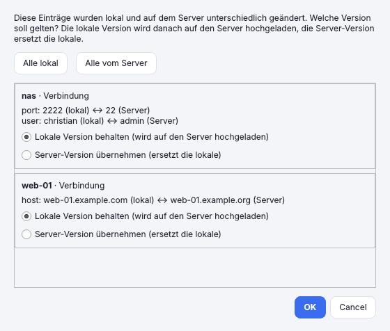
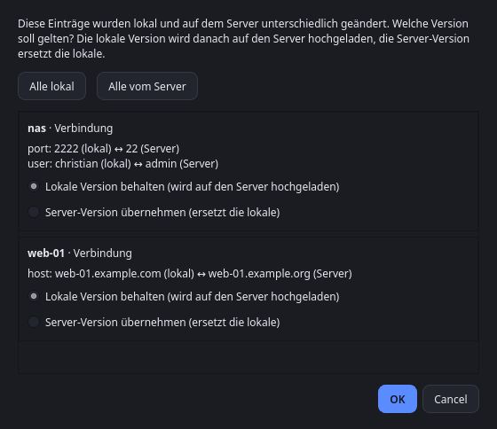

# Synchronisation und Daten

← [Zur README](../README.md) · *[English version](en/synchronisation.md)*

## Synchronisation über Git

*Einstellungen › Synchronisation …* gleicht Verbindungen, Gruppen, Identitäten, Schlüssel und Snippets über ein Git-Repository ab (Terminals und
Fensterbreiten bleiben pro Gerät). Das Tool nutzt das installierte `git`. Die Anmeldung läuft im Hintergrund ohne Rückfragen:
- **SSH-Schlüssel** (`git@server:…`): wie sonst auch mit `git`.
- **Benutzername und Passwort bzw. Token** (`https://…`): im Dialog unter *Benutzername* und *Passwort / Token* eintragen. Das Passwort liegt im Schlüsselbund
  des Systems (nicht in der Konfigurationsdatei) und wird git nur über die Umgebung des Prozesses übergeben, nie in der Befehlszeile oder in der URL.
  Bei GitHub, GitLab und Gitea ist statt des Kontopassworts meist ein Zugriffstoken nötig. Löschst du den Benutzernamen, entfernt Sesam auch das gespeicherte Passwort.
- **Bereits gespeicherte Git-Zugangsdaten:** bleibt der Benutzername leer, gelten die Einstellungen von `git` (z. B. `git credential`-Helfer; einmal vorher per *Verbindung testen* oder `git ls-remote` anmelden).

- **Automatisch:** beim Start und kurz nach jeder Änderung. *F5* bzw. *Jetzt synchronisieren* löst den Abgleich manuell aus; der Status steht rechts unten.
- **Repository-Aufbau:** eine JSON-Datei pro Eintrag (`connections/`, `identities/`, `ssh_keys/`, `snippets/`), `groups.json`, `meta.json`. Das Repository darf privat sein, ist aber für Klartext-Daten wie Hostnamen und Benutzer sichtbar.
- **Passwörter** werden nur verschlüsselt abgelegt (scrypt + AES-256-GCM) und auf jedem Gerät in den Schlüsselbund geschrieben. Das **Sync-Passwort** (mindestens 12 Zeichen für ein neues Repository – bestehende Repositories mit kürzerem Passwort aus älteren Versionen funktionieren weiter; scrypt mit N=2¹⁷ bei neuen Repositories) legst du auf dem ersten Gerät fest und gibst es auf jedem weiteren ein. Es lässt sich nicht wiederherstellen und auch nicht ohne Weiteres ändern. Ohne Passwort-Sync bleiben vorhandene verschlüsselte Einträge im Repository erhalten.
- **Manipulationsschutz:** Mit Sync-Passwort wird jeder Eintrag zusätzlich signiert (HMAC-SHA-256). Einträge, die jemand direkt im Repository ändert (z. B. Host oder `ProxyCommand`), lehnt Sesam ab, behält die lokale Version, schreibt sie korrekt signiert zurück und meldet „abgelehnt“. Bestehende Repositories werden beim ersten Abgleich mit Sync-Passwort automatisch umgestellt – dafür auf allen Geräten aktualisieren. Geräte ohne Sync-Passwort können nicht signieren; ihre Änderungen werden von Geräten mit Passwort abgelehnt. Nicht abgedeckt: das Löschen von Einträgen und das Zurückspielen älterer, gültig signierter Stände.
- **Zusammenführen:** je Eintrag ein Dreiwege-Vergleich mit dem Stand des letzten Abgleichs. Änderungen an verschiedenen Einträgen werden kombiniert, Löschungen übernommen. Wurde derselbe Eintrag auf zwei Geräten unterschiedlich geändert, fragt Sesam, welche Version gelten soll: die lokale (wird danach auf den Server hochgeladen) oder die Server-Version (ersetzt die lokale). Es entstehen keine Kopien. Mit *Abbrechen* wird der Abgleich ohne Änderung beendet und beim nächsten Mal erneut gefragt.

  | Hell | Dunkel |
  |---|---|
  |  |  |

- **Doppelte Einträge:** Dieselbe Verbindung (gleicher Name, Host, Port, Benutzer und Gruppe) oder Identität (Name und Benutzer), die auf zwei Geräten getrennt angelegt wurde (z. B. durch *Aus ~/.ssh/config importieren* auf beiden), erkennt Sesam beim Abgleich als einen Eintrag: Die ID vom Server gilt, das lokale Passwort wandert mit, es entsteht keine zweite Verbindung. Unterscheiden sich die Einträge in weiteren Feldern, fragt Sesam wie bei einem Konflikt. Das gilt nur für Einträge, die beide Seiten noch nicht aus einem früheren Abgleich kennen. Bereits vorhandene Duplikate entfernt *Doppelte Verbindungen zusammenführen …* im Kontextmenü der Liste (je Gruppe bleibt eine, bevorzugt die mit gespeichertem Passwort).
- Wird eine Identität oder ein Schlüssel gelöscht, verlieren Verbindungen, die sie nutzen, den Verweis.
- Leeres Repository anlegen (z. B. bei GitHub/GitLab/Gitea) genügt, das Tool erstellt den Branch selbst.

## Daten

Konfiguration: `~/.config/sesam/config.json` (Linux), `%APPDATA%\sesam\config.json` (Windows).
Passwörter stehen nie in dieser Datei, sondern im Schlüsselbund des Betriebssystems; ohne gespeichertes Passwort läuft die Anmeldung über ssh (Schlüssel, Agent, Abfrage im Terminal).

Ist `config.json` beschädigt (kein gültiges JSON o. Ä.), löscht Sesam sie nicht: Die Datei wird als `config.json.defekt-<Datum>-<Uhrzeit>` daneben gesichert,
Sesam zeigt eine Meldung mit dem Grund und startet mit leerer Konfiguration. Du kannst die Sicherung reparieren und als `config.json` zurückkopieren.
Mit aktiver Git-Synchronisation richtest du sie wieder ein; die Verbindungen kommen dann aus dem Repository zurück. Kann die Datei nicht gelesen oder nicht gesichert werden,
startet Sesam nicht und ändert nichts.

Alte Daten aus der früheren Version („ssh_verwaltung“) werden beim ersten Start automatisch übernommen: der Konfigurationsordner wird umbenannt, Passwörter ziehen im Schlüsselbund um.
